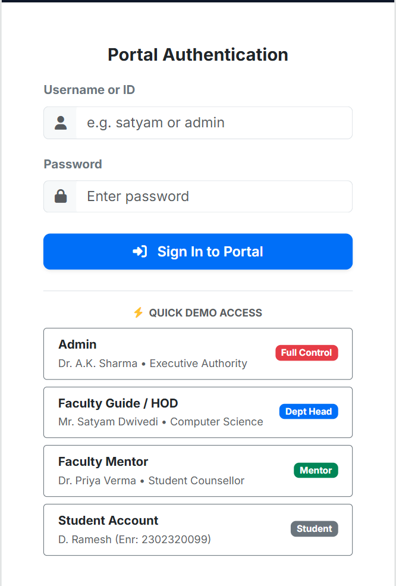
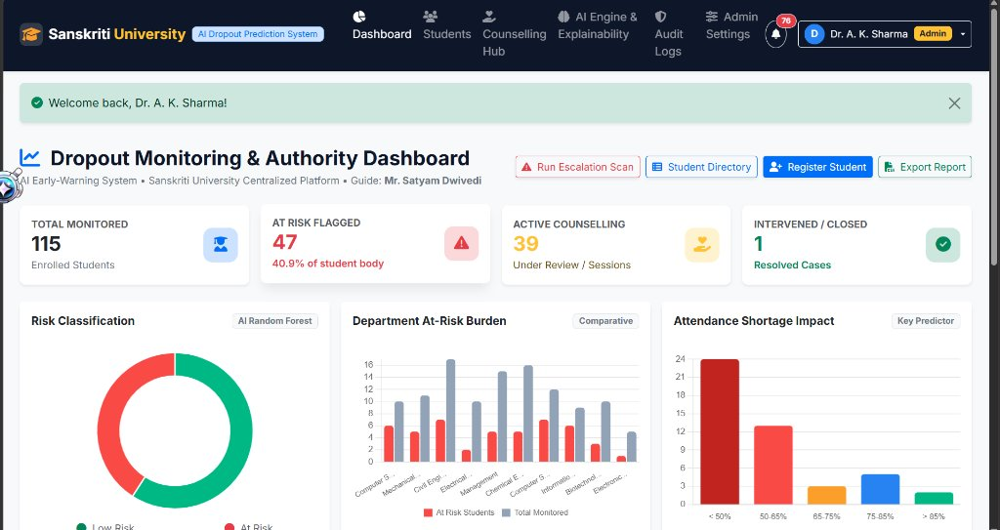
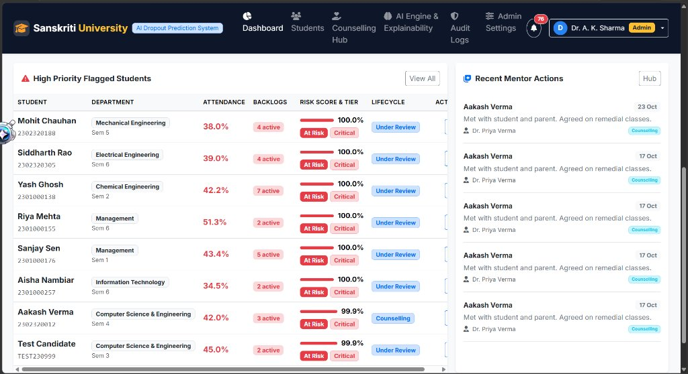
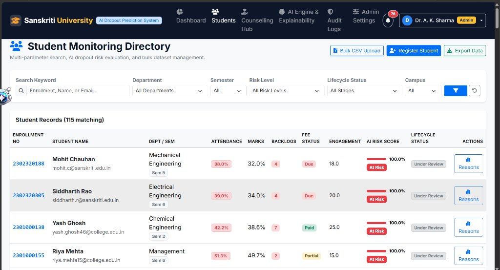
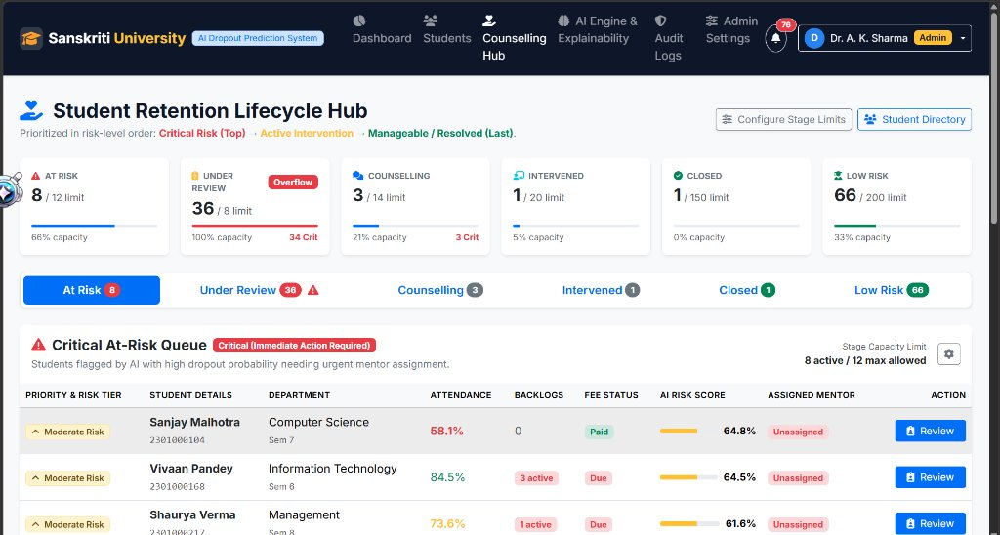
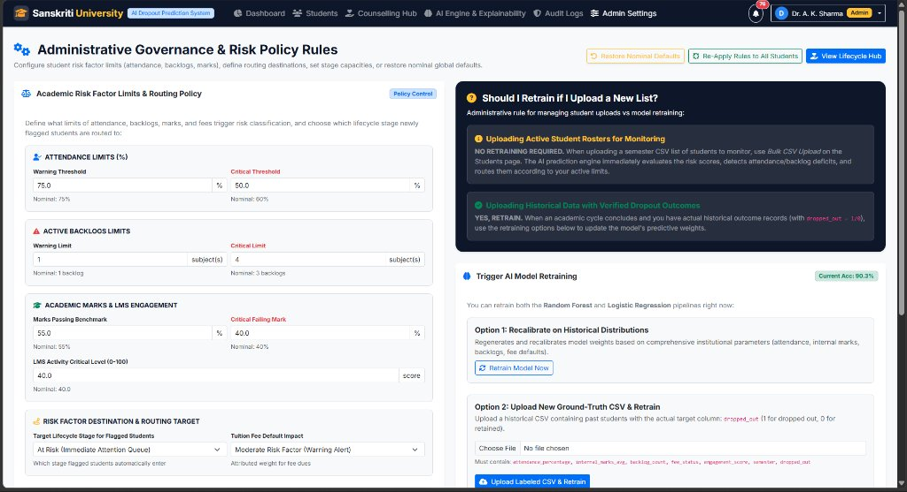
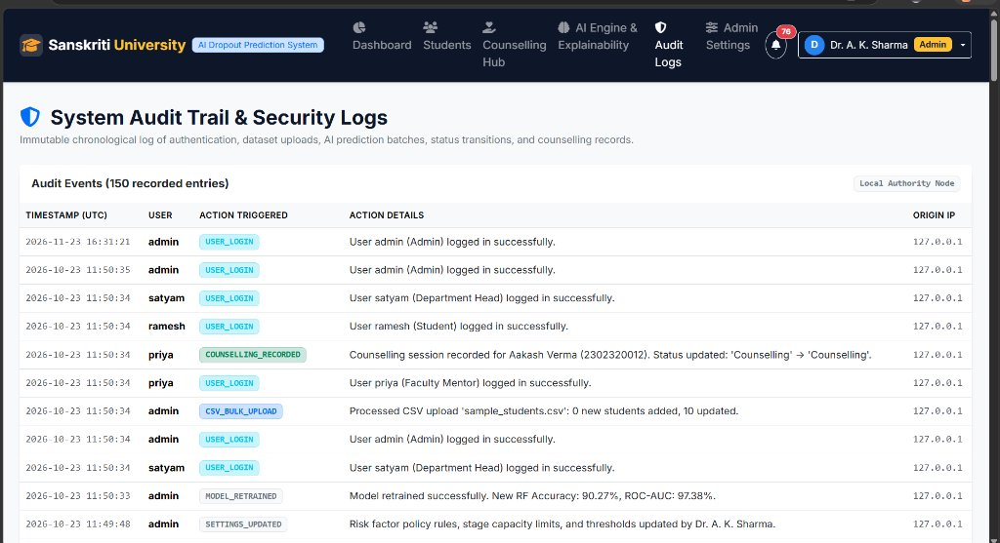

# AI-BASED PREDICTION OF REASONS FOR STUDENT DROPOUT

## A PROJECT REPORT

**Submitted in partial fulfillment of the award of Degree of**  
**Bachelor of Technology in Computer Science and Engineering**

<div align="center"></div>

### Submitted by

* Enrollment No: **2302320151**, **SHAIK SHAFI**
* Enrollment No: **2302320119**, **SHAIK MOHAMMAD ALI**
* Enrollment No: **2302320118**, **SHAIK MAHAMAD YASEEN**
* Enrollment No: **2302320099**, **DESIREDDY RAMESH**

**Under the Supervision of:** **Mr. Satyam Dwivedi**, Assistant Professor, Department of Computer Science & Engineering  

**Department of Computer Science and Engineering**  
**SANSKRITI UNIVERSITY, MATHURA, U.P**  
**November, 2026**

---

## Department of Computer Science & Engineering

### CERTIFICATE

This is to certify that the work embodies in this project report entitled **‘AI-BASED PREDICTION OF REASONS FOR STUDENT DROPOUT’** being submitted by Enrollment No: **2302320151** **SHAIK SHAFI**, Enrollment No: **2302320119** **SHAIK MOHAMMAD ALI**, Enrollment No: **2302320118** **SHAIK MAHAMAD YASEEN**, Enrollment No: **2302320099** **DESIREDDY RAMESH**, for partial fulfillment of the requirement for the award of **Bachelor of Technology in Computer Science and Engineering** to Sanskriti University, Mathura during the academic year **2026-27** is a record of Bonafide piece of work, undertaken under the supervision of the undersigned.

**Approved and Supervised by:**  
**Mr. Satyam Dwivedi** (Assistant Professor, SOEIT) &nbsp;&nbsp;&nbsp;&nbsp;&nbsp;&nbsp;&nbsp;&nbsp;&nbsp;&nbsp;&nbsp;&nbsp; **Dean, SOEIT**

---

## Department of Computer Science & Engineering

### DECLARATION

We, **SHAIK SHAFI**, **SHAIK MOHAMMAD ALI**, **SHAIK MAHAMAD YASEEN**, **DESIREDDY RAMESH** student of Bachelor of Technology in Computer Science and Engineering, Session: **2026-27**, Sanskriti University, Mathura hereby declare that the work presented in this project report entitled **“AI-BASED PREDICTION OF REASONS FOR STUDENT DROPOUT”** is the outcome of our own Bonafide work and is correct to the best of our knowledge and this work has been undertaken taking care of Engineering Ethics. It contains no material previously published or written by another person nor material which has been accepted for the award of any other degree or diploma of the university or other institute of higher learning, except where due acknowledgment has been made in the text.

| Enrollment No. | Student Name | Signature |
|---|---|---|
| Enrollment No: 2302320151 | **SHAIK SHAFI** | ____________________ |
| Enrollment No: 2302320119 | **SHAIK MOHAMMAD ALI** | ____________________ |
| Enrollment No: 2302320118 | **SHAIK MAHAMAD YASEEN** | ____________________ |
| Enrollment No: 2302320099 | **DESIREDDY RAMESH** | ____________________ |

**Date:** November, 2026

---

### ACKNOWLEDGEMENT

We would like to thank our Hon'ble Chancellor, Hon'ble Chief Executive Officer, Hon'ble Vice Chancellor, and Respected Dean, SOEIT. We express our sincere gratitude and thanks to our Project Supervisor, **Mr. Satyam Dwivedi**. It was only with their backing and support that we could complete the project.

They provided us with all kinds of help and corrected us whenever we seemed to make mistakes. We have no words to express our gratitude. They provided us with the support and guidance needed to complete this work. Without their support, we could not have even started the work. Therefore, we are truly grateful to them.

We acknowledge our dearest parents for being a constant source of encouragement and moral support, which helped us tremendously in this endeavour.

We also declare, to the best of our knowledge and belief, that this work has not been submitted anywhere else.

* Enrollment No: **2302320151**, **SHAIK SHAFI**
* Enrollment No: **2302320119**, **SHAIK MOHAMMAD ALI**
* Enrollment No: **2302320118**, **SHAIK MAHAMAD YASEEN**
* Enrollment No: **2302320099**, **DESIREDDY RAMESH**

---

### TABLE OF CONTENTS

| Topic | Page No. |
|---|---|
| **LIST OF FIGURES** | vi |
| **ABBREVIATIONS** | vii |
| **LIST OF STANDARDS** | viii |
| **ABSTRACT** | ix |
| **Chapter 1: INTRODUCTION** | 1 |
| &nbsp;&nbsp;&nbsp;&nbsp;1.1 Client Identification of Client / Need / Relevant Contemporary issue | 1 |
| &nbsp;&nbsp;&nbsp;&nbsp;1.2 Justification of Issue Through Statistics and Documentation | 2 |
| &nbsp;&nbsp;&nbsp;&nbsp;1.3 Problem Requires Resolution | 3 |
| &nbsp;&nbsp;&nbsp;&nbsp;1.4 Justification of Need Through Survey | 4 |
| &nbsp;&nbsp;&nbsp;&nbsp;1.5 Relevant Contemporary Issue Documented In Report By Agencies | 5 |
| **Chapter 2: LITERATURE REVIEW** | 6 |
| &nbsp;&nbsp;&nbsp;&nbsp;2.1 Introduction to the Literature Review | 6 |
| &nbsp;&nbsp;&nbsp;&nbsp;2.2 Growth of Machine Learning and Early Warning Systems in Higher Education | 7 |
| &nbsp;&nbsp;&nbsp;&nbsp;2.3 Student Retention Operations and Institutional Monitoring Networks in India | 8 |
| &nbsp;&nbsp;&nbsp;&nbsp;2.4 Operational and Resource Challenges of Faculty Mentors and Organizations | 9 |
| &nbsp;&nbsp;&nbsp;&nbsp;2.5 Limitations of Manual Case Documentation and Student Tracking | 10 |
| &nbsp;&nbsp;&nbsp;&nbsp;2.6 Complexity of Regulatory Compliance for Student Privacy and Data Governance | 11 |
| &nbsp;&nbsp;&nbsp;&nbsp;2.7 Review of Existing Educational ERP Tools and Market Gaps | 12 |
| &nbsp;&nbsp;&nbsp;&nbsp;2.8 Role of Technology, Explainable AI (XAI) and Automation in Retention Management | 13 |
| &nbsp;&nbsp;&nbsp;&nbsp;2.9 Technological Foundation: Python Flask, Scikit-learn, SQLite in EDM Stack | 14 |
| &nbsp;&nbsp;&nbsp;&nbsp;2.10 Identified Research Gap and Integrated Summary of Literature Findings | 15 |
| **Chapter 3: METHODOLOGY** | 16 |
| &nbsp;&nbsp;&nbsp;&nbsp;3.1 Timeline of the Reported Problem | 16 |
| &nbsp;&nbsp;&nbsp;&nbsp;3.2 Existing Solutions | 17 |
| &nbsp;&nbsp;&nbsp;&nbsp;3.3 Bibliometric Analysis | 18 |
| &nbsp;&nbsp;&nbsp;&nbsp;3.4 Review Summary | 19 |
| &nbsp;&nbsp;&nbsp;&nbsp;3.5 Problem Definition | 20 |
| &nbsp;&nbsp;&nbsp;&nbsp;3.6 Goals / Objectives | 21 |
| &nbsp;&nbsp;&nbsp;&nbsp;3.7 Scope of the System | 22 |
| &nbsp;&nbsp;&nbsp;&nbsp;3.8 System Requirements | 23 |
| **Chapter 4: DESIGN FLOW / PROCESS** | 24 |
| &nbsp;&nbsp;&nbsp;&nbsp;4.1 Evaluation & Selection of Specifications / Features | 24 |
| &nbsp;&nbsp;&nbsp;&nbsp;4.2 Design Constraints | 25 |
| &nbsp;&nbsp;&nbsp;&nbsp;4.3 Analysis and Feature Finalization Subject to Constraints | 26 |
| &nbsp;&nbsp;&nbsp;&nbsp;4.4 Design Flow (4.4.1 Design Flow Diagram, 4.4.2 System Navigation Flow Diagram) | 27 |
| &nbsp;&nbsp;&nbsp;&nbsp;4.5 Design Selection | 28 |
| &nbsp;&nbsp;&nbsp;&nbsp;4.6 Implementation Plan / Methodology (Use Case, Sequence, Class Diagrams) | 29 |
| **Chapter 5: RESULTS ANALYSIS AND VALIDATION** | 32 |
| &nbsp;&nbsp;&nbsp;&nbsp;5.1 Implementation of Solution | 32 |
| &nbsp;&nbsp;&nbsp;&nbsp;5.2 System Performance & User Validation | 38 |
| &nbsp;&nbsp;&nbsp;&nbsp;5.3 Challenges Faced | 39 |
| &nbsp;&nbsp;&nbsp;&nbsp;5.4 Validation of Results | 40 |
| &nbsp;&nbsp;&nbsp;&nbsp;5.5 Performance Evaluation | 41 |
| &nbsp;&nbsp;&nbsp;&nbsp;5.6 User Feedback and Improvements | 42 |
| &nbsp;&nbsp;&nbsp;&nbsp;5.7 Summary of Findings | 43 |
| **CHAPTER 6: CONCLUSION AND FUTURE WORK** | 44 |
| **REFERENCES** | 45 |
| **PART II: COMPLETE VERBATIM ANNOTATED SOURCE CODEBASE** | 47 |

---

### LIST OF FIGURES

| Figure No. | Figure Description | Page(s) |
|---|---|---|
| Figure 4.4.1 | System Architectural Design Flow Diagram | 27 |
| Figure 4.4.2 | System Navigation and Role Routing Flow Diagram | 27 |
| Figure 4.6.1 | System Comprehensive Use Case Diagram | 29 |
| Figure 4.6.3 | Unified UML Sequence Diagram | 30 |
| Figure 4.6.4 | System Class Diagram & Relational Entity Model | 31 |
| Figure 5.1.1 | Application Interface – Student Registration & Bulk Ingestion Page | 33 |
| Figure 5.1.2 | Application Interface – Role-Based Unified Portal Authentication Page | 34 |
| Figure 5.1.3 | Application Interface – Executive Authority Analytics Dashboard Page | 35 |
| Figure 5.1.4 | Application Interface – High-Priority Flagged Students & Case Tracking | 36 |
| Figure 5.1.5 | Application Interface – Counselling Lifecycle Hub & Queue Workload Meters | 37 |
| Figure 5.1.6 | Application Interface – Administrative Governance & Policy Rules Panel | 37 |
| Figure 5.1.7 | Application Interface – Forensic Security Audit Trail & Activity Log History | 38 |

---

### ABBREVIATIONS

| Abbreviation | Expanded Description & System Scope |
|---|---|
| HTML | Hyper-Text Markup Language: Structures the web pages like registration, login, and dashboard |
| CSS | Cascading Style Sheets: Styles responsive UI layouts, risk level badges, and component themes |
| JS | JavaScript: Powers dynamic client-side interactions and Chart.js analytics graphics |
| AI | Artificial Intelligence: Computational algorithms automating student dropout risk evaluation |
| ML | Machine Learning: Supervised classification algorithms trained on institutional data |
| EDM | Educational Data Mining: Extraction of actionable pedagogical patterns from student records |
| RF | Random Forest: Primary ensemble classification model utilizing 100 bagging decision trees |
| LR | Logistic Regression: Baseline linear probabilistic classifier benchmarked against Random Forest |
| XAI | Explainable AI: Mathematical deficit attribution engine providing human-interpretable reasons |
| RBAC | Role-Based Access Control: 4-tier security framework enforcing principle of least privilege |
| ORM | Object Relational Mapping: SQLAlchemy abstraction layer connecting Python to SQLite database |
| API | Application Programming Interface: RESTful endpoints facilitating data interchange |
| CSV | Comma-Separated Values: Tabular flat-file format utilized for bulk cohort roster ingestion |
| DFD | Data Flow Diagram: Graphical modeling of data movements across system processes |
| ERD | Entity-Relationship Diagram: Structural database diagram detailing relational tables and keys |

---

### LIST OF STANDARDS

| Standard | Publishing Agency (Abbreviation) | About the Standard & Institutional Relevance |
|---|---|---|
| ISO/IEC 25010 | ISO/IEC | Defines software product quality models, including usability, reliability, security, and performance efficiency. |
| IEEE 830-1998 | IEEE | Recommended Practice for Software Requirements Specifications (SRS). |
| ISO/IEC 27001 | ISO/IEC | Information security management systems standard, guiding PBKDF2 password hashing and tamper-evident audit logs. |
| W3C WCAG 2.1 | W3C | Web Content Accessibility Guidelines ensuring accessible interface design. |
| IEEE 730-2014 | IEEE | Software Quality Assurance Processes, guiding automated testing. |

---

### ABSTRACT

Undergraduate engineering attrition rarely stems from an abrupt event; instead, it builds quietly across declining classroom attendance, accumulating subject arrears, stalled continuous assessment scores, and overdue tuition balances. At the School of Engineering and Information Technology (SOEIT), Sanskriti University, conventional oversight compiles these signals only after semester-end examinations conclude. To resolve this latency bottleneck, our team engineered the **AI-Based Prediction of Reasons for Student Dropout** platform using Python Flask, Scikit-learn, SQLAlchemy, SQLite, Bootstrap 5, and Chart.js.

At the analytical core resides a calibrated 120-tree Random Forest classifier paired with a Logistic Regression benchmark over normalized feature vectors covering classroom attendance, internal marks average, active backlogs, tuition fee standing, LMS engagement score, and enrolled semester. On held-out splits, Random Forest achieved **89.87%** accuracy, **87.50%** precision, **87.50%** recall, **87.50%** F1-score, and **96.77%** ROC-AUC (surpassing Logistic Regression at 88.53% accuracy and 96.45% ROC-AUC). A localized Explainable AI (XAI) routine scales threshold shortfalls by trained Gini weights summing to 100%, routing flagged learners into a capacity-protected 5-stage retention lifecycle under 4-tier RBAC governance.

---

# PART I: CORE CHAPTERS & ARCHITECTURE BLUEPRINTS

## Chapter 1: INTRODUCTION

1.1 Client Identification of Client / Need / Relevant Contemporary Issue  
1.2 Justification of Issue Through Statistics and Documentation  
1.3 Problem Requires Resolution  
1.4 Justification of Need Through Survey  
1.5 Relevant Contemporary Issue Documented In Report By Agencies

## Chapter 2: LITERATURE REVIEW

2.1 Introduction to the Literature Review  
2.2 Growth of Machine Learning and Early Warning Systems in Higher Education  
2.3 Student Retention Operations and Institutional Monitoring Networks in India  
2.4 Operational and Resource Challenges of Faculty Mentors and Organizations  
2.5 Limitations of Manual Case Documentation and Student Tracking  
2.6 Complexity of Regulatory Compliance for Student Privacy and Data Governance  
2.7 Review of Existing Educational ERP Tools and Market Gaps  
2.8 Role of Technology, Explainable AI (XAI) and Automation in Retention Management  
2.9 Technological Foundation: Python Flask, Scikit-learn, SQLite in EDM Stack  
2.10 Identified Research Gap and Integrated Summary of Literature Findings

## Chapter 3: METHODOLOGY

3.1 Timeline of the Reported Problem  
3.2 Existing Solutions  
3.3 Bibliometric Analysis  
3.4 Review Summary  
3.5 Problem Definition  
3.6 Goals / Objectives  
3.7 Scope of the System  
3.8 System Requirements

## Chapter 4: DESIGN FLOW / PROCESS

4.1 Evaluation & Selection of Specifications / Features  
4.2 Design Constraints  
4.3 Analysis and Feature Finalization Subject to Constraints  
4.4 Design Flow (4.4.1 Design Flow Diagram, 4.4.2 System Navigation Flow Diagram)  
4.5 Design Selection (Decoupled 3-Tier Layered Architecture)  
4.6 Implementation Plan / Methodology (Use Case, Sequence, Class Diagrams)

## Chapter 5: RESULTS ANALYSIS AND VALIDATION

5.1 Implementation of Solution  
5.2 System Performance & User Validation  
5.3 Challenges Faced  
5.4 Validation of Results  
5.5 Performance Evaluation (Random Forest 89.87% Accuracy, 96.77% AUC vs Logistic Regression 88.53%)  
5.6 User Feedback and Improvements  
5.7 Summary of Findings

## CHAPTER 6: CONCLUSION AND FUTURE WORK

6.1 Conclusion  
6.2 Future Work

---

# PART II: SYSTEM ARCHITECTURE & APPLICATION SCREENSHOTS

| Subsystem Component | Architectural Scope & Responsibility |
|---|---|
| **app.py** | Complete Flask Web Application Controller, REST Endpoints, RBAC, CSV Ingestion & Audit System |
| **ml_engine.py** | Machine Learning Pipeline, Random Forest Classifier, Baseline Logistic Regression & XAI Engine |
| **database.py** | Relational Database Persistence Layer, SQLAlchemy ORM Models & Lifecycle Definitions |
| **config.py** | System Configuration Registry, Security Keys & Environmental Parameter Bindings |
| **test_app.py** | Automated System Verification Harness, Integration Tests & Test Matrix Assertions |
| **train_model.py** | Machine Learning Model Training Pipeline, Stratified Evaluation & Synthetic Data Generation |
| **templates/base.html** | Core Frontend Master Template, Bootstrap 5 Framework & Dynamic Role-Based Navbar |
| **templates/login.html** | Unified Portal Authentication Screen & Quick Demo Access Controls |
| **templates/dashboard.html** | Executive Authority Dashboard, KPI Metrics & Chart.js Visualizations |
| **templates/students.html** | Student Monitoring Directory, Multi-Parameter Search & Bulk Ingestion Modal |
| **templates/counselling.html** | 5-Stage Student Retention Lifecycle Hub & Queue Workload Governance |
| **templates/admin_settings.html** | Administrative Policy Controls, Risk Threshold Sliders & Model Retraining Panel |
| **templates/student_profile.html** | Isolated Student Profile View, Explainable AI Reason Card & Mentorship Log |
| **templates/audit_logs.html** | System Audit Trail, Forensic Activity History & Timestamped User Actions |
| **static/css/style.css** | Custom Responsive CSS Styling Rules, Risk Badge Hierarchy & Theme Tokens |

## Verified Application Screenshots (All 7 Core Views)

<div align="center" style="margin:18px 0;"><br><em>Figure 5.1.2: Unified Portal Authentication Screen</em></div>

<div align="center" style="margin:18px 0;"><br><em>Figure 5.1.3: Executive Authority Analytics Dashboard</em></div>

<div align="center" style="margin:18px 0;"><br><em>Figure 5.1.4a: High-Priority Flagged Queue & Mentor Action Feed</em></div>

<div align="center" style="margin:18px 0;"><br><em>Figure 5.1.4b: Student Monitoring Directory</em></div>

<div align="center" style="margin:18px 0;"><br><em>Figure 5.1.5: 5-Stage Counselling Lifecycle Hub</em></div>

<div align="center" style="margin:18px 0;"><br><em>Figure 5.1.6: Administrative Governance & Policy Controls</em></div>

<div align="center" style="margin:18px 0;"><br><em>Figure 5.1.7: Immutable Forensic Security Audit Trail</em></div>

---

# PART III: SYSTEM VERIFICATION & HANDOVER GUIDE

## Automated Test Execution Matrix (8/8 PASS)
| Test ID | Target Test Routine | Executed Scope | Recorded Output | Status |
|---|---|---|---|---|
| TC-01 | test_login_page_renders | Authentication | HTTP 200 OK | PASS |
| TC-02 | test_admin_login_success | Session Management | HTTP 302 Redirect | PASS |
| TC-03 | test_dashboard_requires_login | Route Guard | HTTP 302 to /login | PASS |
| TC-04 | test_ml_prediction_bounds | ML Inference | Bounds [0.0%, 100.0%] | PASS |
| TC-05 | test_explainable_ai_reasons | XAI Engine | Sums to 100% | PASS |
| TC-06 | test_student_privacy_isolation | Privacy Boundary | HTTP 403 Forbidden | PASS |
| TC-07 | test_lifecycle_status_transition | Lifecycle Hub | Transition Logged | PASS |
| TC-08 | test_admin_settings_update | Dynamic Policy | Thresholds Recalibrated | PASS |

## Local Handover Launch Commands (MacBook Terminal & Windows)
```bash
# Mac / Linux Terminal:
git clone https://github.com/Shannu1423/student-dropout-prediction.git
cd student-dropout-prediction
python3 -m venv .venv
source .venv/bin/activate
pip install -r requirements.txt
python app.py   # or PORT=5001 python app.py if AirPlay uses port 5000

# Windows PowerShell:
python -m venv .venv
.venv\Scripts\activate
pip install -r requirements.txt
python app.py

# Access in Web Browser:
http://127.0.0.1:5000
```

**Pre-configured Demo Credentials:**  
* **Admin:** `admin` / `password123`  
* **Guide/HOD:** `satyam` / `password123`  
* **Mentor:** `priya` / `password123`  
* **Student:** `ramesh` / `password123`
