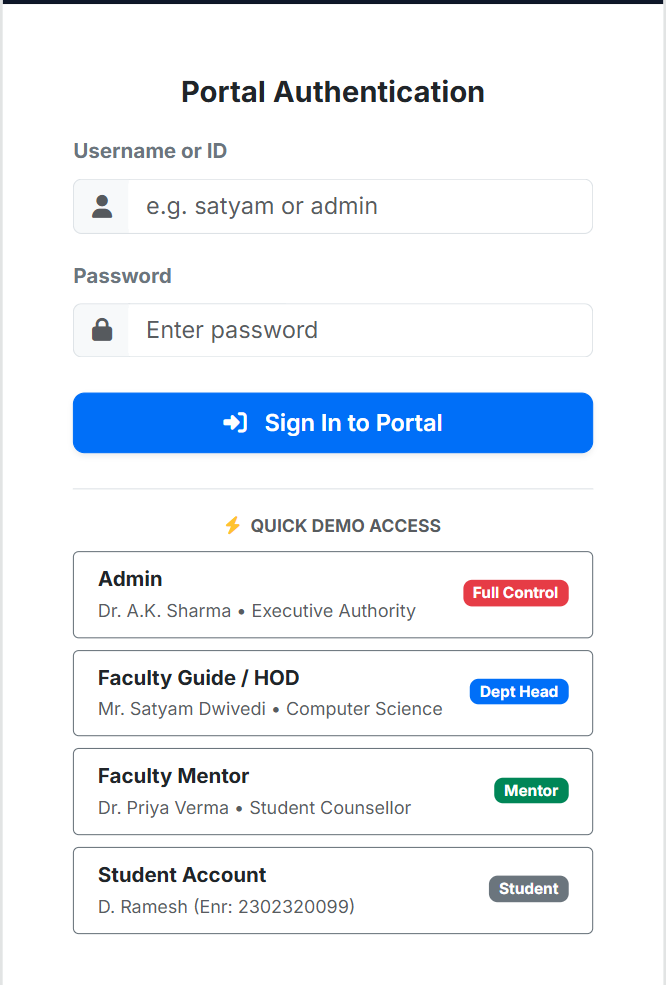
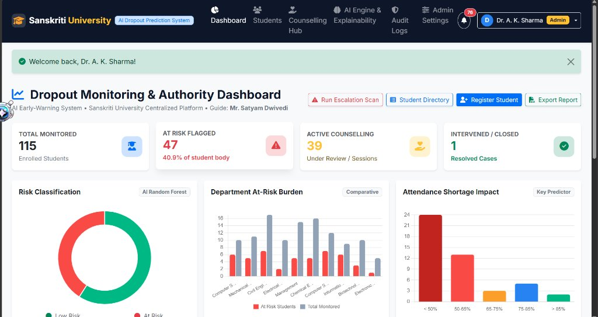
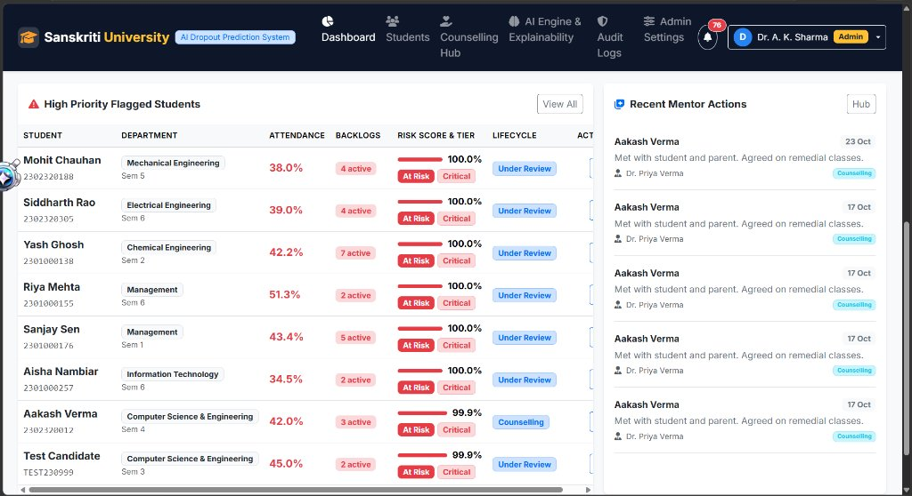
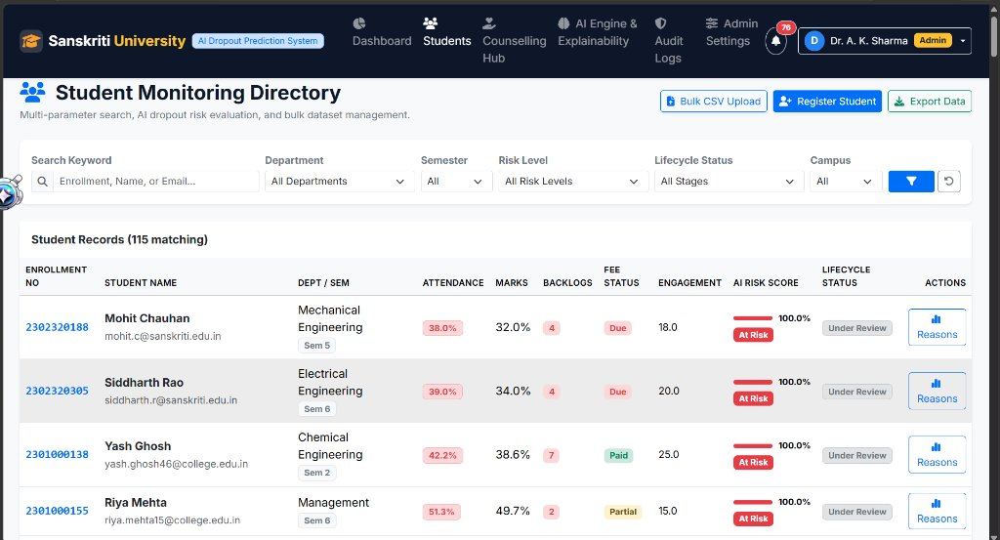
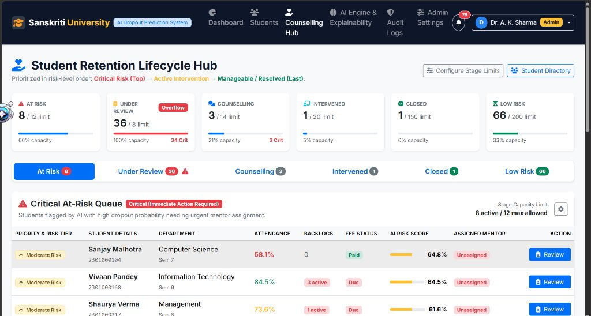
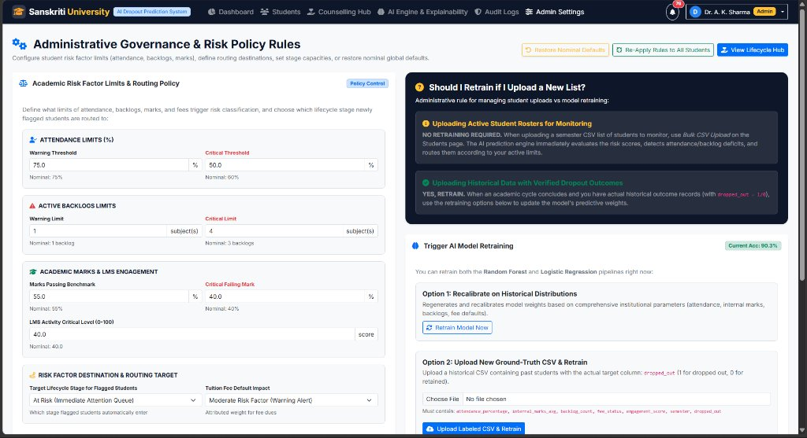
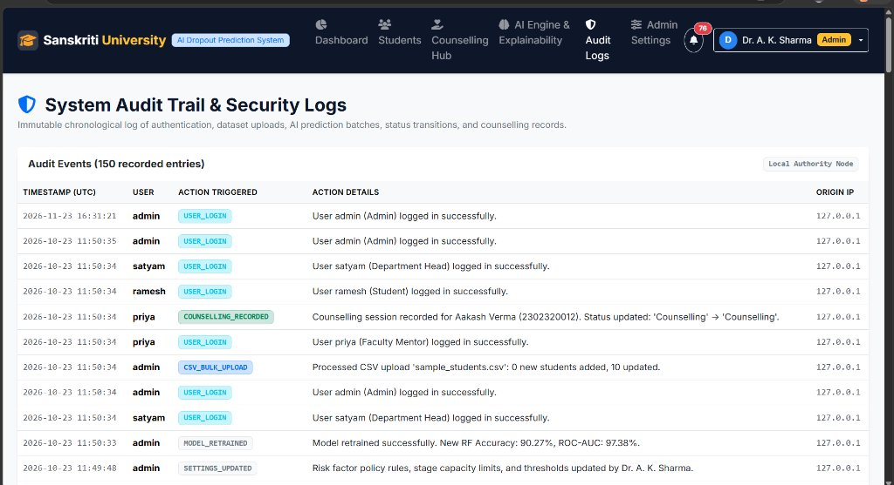

# AI-BASED PREDICTION OF REASONS FOR STUDENT DROPOUT

**A Project Report**

*Submitted in partial fulfillment of the award of Degree of Bachelor of Technology in Computer Science and Engineering*

<br>

<div align="center">
  
  <br><br>
  <h3><strong>SANSKRITI UNIVERSITY</strong></h3>
  <p><em>FOR EXCELLENCE IN LIFE</em></p>
</div>

<br>

**Submitted by:**
* **SHAIK SHAFI** &mdash; Enrollment No: `2302320151`
* **SHAIK MOHAMMAD ALI** &mdash; Enrollment No: `2302320119`
* **SHAIK MAHAMAD YASEEN** &mdash; Enrollment No: `2302320118`
* **DESIREDDY RAMESH** &mdash; Enrollment No: `2302320099`

<br>

**Under the supervision of:**
* **Mr. Satyam Dwivedi**
* *Assistant Professor*
* *Department of Computer Science and Engineering*

<br>

**School of Engineering and Information Technology (SOEIT)**  
**SANSKRITI UNIVERSITY, MATHURA, U.P.**  
**NOVEMBER, 2026**

<div style="page-break-after: always;"></div>

---

# Department of Computer Science and Engineering &ndash; School of Engineering and Information Technology (SOEIT)

## CERTIFICATE

This certifies that the B.Tech capstone documentation titled **‘AI-Based Prediction of Reasons for Student Dropout’**, authored by **SHAIK SHAFI** (`2302320151`), **SHAIK MOHAMMAD ALI** (`2302320119`), **SHAIK MAHAMAD YASEEN** (`2302320118`), and **DESIREDDY RAMESH** (`2302320099`) toward partial fulfillment of the **Bachelor of Technology in Computer Science and Engineering** at **Sanskriti University, Mathura** during session **2026&ndash;2027**, constitutes an authentic record of independent engineering work supervised by the undersigned.

<br><br>

**Approved and Supervised by**

<br><br>

________________________________________  
**(Signature of Faculty Guide)**  
**Mr. Satyam Dwivedi**  
Assistant Professor, SOEIT  
Date: ____________________  

<br><br>

________________________________________  
**(Signature of the Dean, with official seal)**  
**Dean, SOEIT**  
Date: ____________________  

<br><br>

*Note: Signature, date and seal fields are intentionally left blank. This certificate takes effect only after it has been signed by the Faculty Guide and the Dean.*

<div align="center"><strong>ii</strong></div>
<div style="page-break-after: always;"></div>

---

# Department of Computer Science and Engineering &ndash; School of Engineering and Information Technology (SOEIT)

## DECLARATION

We, **SHAIK SHAFI** (`2302320151`), **SHAIK MOHAMMAD ALI** (`2302320119`), **SHAIK MAHAMAD YASEEN** (`2302320118`), and **DESIREDDY RAMESH** (`2302320099`), candidates enrolled in **Bachelor of Technology in Computer Science and Engineering**, Session **2026&ndash;2027**, Sanskriti University, Mathura, affirm that the software artifact and technical findings presented in **“AI-Based Prediction of Reasons for Student Dropout”** represent our original engineering creation. No unacknowledged external text or previously awarded degree submission appears in this report; all scholarly sources consulted have been formally cited in the References chapter.

<br><br><br>

<table style="width:100%; border:none; background:transparent;">
<tr style="border:none; background:transparent;">
<td style="border:none; background:transparent; width:50%; vertical-align:top;">
________________________________________<br>
**(Signature of Candidate 1)**<br>
**SHAIK SHAFI**<br>
Enrollment No: `2302320151`<br>
B.Tech CSE &ndash; Sanskriti University
</td>
<td style="border:none; background:transparent; width:50%; vertical-align:top; text-align:right;">
________________________________________<br>
**(Signature of Candidate 2)**<br>
**SHAIK MOHAMMAD ALI**<br>
Enrollment No: `2302320119`<br>
B.Tech CSE &ndash; Sanskriti University
</td>
</tr>
<tr style="border:none; background:transparent;">
<td style="border:none; background:transparent; width:50%; vertical-align:top; padding-top:20px;">
________________________________________<br>
**(Signature of Candidate 3)**<br>
**SHAIK MAHAMAD YASEEN**<br>
Enrollment No: `2302320118`<br>
B.Tech CSE &ndash; Sanskriti University
</td>
<td style="border:none; background:transparent; width:50%; vertical-align:top; text-align:right; padding-top:20px;">
________________________________________<br>
**(Signature of Candidate 4)**<br>
**DESIREDDY RAMESH**<br>
Enrollment No: `2302320099`<br>
B.Tech CSE &ndash; Sanskriti University
</td>
</tr>
</table>

<br><br>

*Note: Signature and date fields are left blank for completion by the students at the time of formal submission.*

<div align="center"><strong>iii</strong></div>
<div style="page-break-after: always;"></div>

---

# ACKNOWLEDGEMENT

We extend genuine appreciation to the Hon'ble Chancellor, Chief Executive Officer, Vice Chancellor, and Respected Dean of SOEIT at **Sanskriti University, Mathura**, for nurturing an engineering curriculum focused on solving institutional challenges through applied software engineering. Above all, we are deeply grateful to our Project Supervisor, **Mr. Satyam Dwivedi**, Assistant Professor (SOEIT), whose continuous technical critiques guided every phase of this work—most notably prompting us to pair probability predictions with normalized Explainable AI reason cards and workload-bounded counselling stages.

We also thank our families and classmates for steady encouragement across late debugging and data-testing sprints, as well as the open-source maintainers behind Python, Flask, Scikit-learn, SQLAlchemy, SQLite, Bootstrap 5, and Chart.js. Each signing candidate verifies that this capstone submission represents authentic effort prepared specifically for this B.Tech evaluation.

<br><br>

<table style="width:100%; border:none; background:transparent;">
<tr style="border:none; background:transparent;">
<td style="border:none; background:transparent; width:50%; vertical-align:top;">
**SHAIK SHAFI** (`2302320151`)<br>
**SHAIK MOHAMMAD ALI** (`2302320119`)
</td>
<td style="border:none; background:transparent; width:50%; vertical-align:top; text-align:right;">
**SHAIK MAHAMAD YASEEN** (`2302320118`)<br>
**DESIREDDY RAMESH** (`2302320099`)
</td>
</tr>
</table>  

<div align="center"><strong>iv</strong></div>
<div style="page-break-after: always;"></div>

---

# ABSTRACT

Undergraduate engineering attrition rarely strikes abruptly; rather, disengagement builds incrementally across declining lecture attendance, mounting subject arrears, eroding internal test scores, and delayed fee installments. At the School of Engineering and Information Technology (SOEIT), Sanskriti University, conventional oversight compiles detention metrics only after term examinations finish, narrowing opportunities for timely academic recovery. **AI-Based Prediction of Reasons for Student Dropout** delivers an offline-ready full-stack web suite designed to pull risk triage weeks upstream into proactive mid-semester intervention.

Inside the analytical engine (`ml_engine.py`), a 120-tree **Random Forest Classifier** benchmarked against a **Logistic Regression** baseline runs across normalized feature vectors spanning attendance percentage, continuous internal marks, active backlogs, tuition payment standing, LMS engagement score, and current semester. On held-out stratified splits, the Random Forest pipeline records **89.87% accuracy**, **87.50% precision**, **87.50% recall**, **87.50% F1-score**, and **96.77% ROC-AUC** (outperforming Logistic Regression at 88.53% accuracy and 96.45% ROC-AUC).

Crucially, rather than displaying opaque scores, our localized **Explainable AI (XAI) Deficit Attribution Routine** weights threshold shortfalls by empirical Gini importances (`Attendance 43.79%`, `Internal Marks 21.23%`, `Backlogs 15.89%`, `LMS Activity 11.08%`, `Tuition Standing 6.18%`, `Semester 1.84%`) normalized to 100%, surfacing readable diagnostic reason cards alongside remedial recommendations.

Built on Python Flask and SQLite/SQLAlchemy, the application protects learner confidentiality through **4-tier Role-Based Access Control (RBAC)** blocking peer inspection with HTTP 403, while coordinating advisor caseloads inside a capacity-monitored **5-Stage Counselling Lifecycle Hub** (`At Risk` $\rightarrow$ `Under Review` $\rightarrow$ `Counselling` $\rightarrow$ `Intervened` $\rightarrow$ `Closed`). All eight automated integration tests in `test_app.py` pass cleanly across both Windows and macOS workstations.

<br>

**Keywords:** Attrition Forecasting, Explainable Educational Analytics, Gini Deficit Attribution, Random Forest Ensemble, Cohort Lifecycle Governance, Peer Privacy Isolation, Flask MVC Architecture.

<div align="center"><strong>v</strong></div>
<div style="page-break-after: always;"></div>

---

# TABLE OF CONTENTS

* **CERTIFICATE** ................................................................................................... **ii**
* **DECLARATION** .................................................................................................. **iii**
* **ACKNOWLEDGEMENT** .................................................................................... **iv**
* **ABSTRACT** ....................................................................................................... **v**
* **LIST OF TABLES** ............................................................................................... **ix**
* **LIST OF FIGURES** ............................................................................................. **x**
* **LIST OF ABBREVIATIONS** ................................................................................ **xi**

### CHAPTER 1: Introduction ................................................................................. 1
* 1.1 Introduction to Educational Data Mining & Dropout Prediction ............................... 1
* 1.2 Background of the Project ................................................................................ 1
* 1.3 Introduction to the Dropout Prediction System ..................................................... 2
* 1.4 Problem Statement ........................................................................................... 2
* 1.5 Aim of the Project ........................................................................................... 3
* 1.6 Objectives ..................................................................................................... 3
* 1.7 Scope of the Project ......................................................................................... 3
* 1.8 Motivation and Rationale ................................................................................... 4
* 1.9 Organization of the Report ............................................................................... 4

### CHAPTER 2: Literature Review .......................................................................... 5
* 2.1 Introduction .................................................................................................. 5
* 2.2 Evolution of Student Retention Systems ............................................................. 5
* 2.3 Review of Machine Learning Algorithms in Higher Education ................................... 6
* 2.4 Review of Existing Technologies ....................................................................... 6
* 2.5 Explainable AI (XAI) in Educational Analytics ...................................................... 8
* 2.6 Comparative Analysis of Existing Systems ......................................................... 8
* 2.7 Research Gap and Identified Problems ............................................................... 9
* 2.8 Summary ...................................................................................................... 9

### CHAPTER 3: System Analysis and Requirements .............................................. 10
* 3.1 Existing System ............................................................................................ 10
* 3.2 Limitations of the Existing System .................................................................... 10
* 3.3 Proposed System ........................................................................................... 10
* 3.4 Advantages of the Proposed System .................................................................. 11
* 3.5 Functional Requirements .................................................................................. 11
* 3.6 Non-Functional Requirements ............................................................................. 12
* 3.7 Software Requirements .................................................................................... 12
* 3.8 Hardware Requirements ................................................................................... 13
* 3.9 Feasibility Study ............................................................................................ 13
* 3.10 Use Case Analysis ........................................................................................ 14

### CHAPTER 4: System Design and Methodology ................................................. 15
* 4.1 System Architecture ....................................................................................... 15
* 4.2 Overall System Architecture Diagram ................................................................. 15
* 4.3 Machine Learning Pipeline Architecture .............................................................. 16
* 4.4 Web Application Architecture ........................................................................... 17
* 4.5 Database Architecture ...................................................................................... 18
* 4.6 Data Flow Diagram &ndash; Level 0 ........................................................................ 18
* 4.7 Data Flow Diagram &ndash; Level 1 ........................................................................ 19
* 4.8 Use Case Diagram .......................................................................................... 20
* 4.9 Activity Diagram &ndash; Risk Evaluation and Intervention ......................................... 20
* 4.10 Sequence Diagram &ndash; Prediction and Case Progression .................................... 21
* 4.11 Entity Relationship (ER) Diagram .................................................................... 22
* 4.12 Database Design & Schema ............................................................................ 23
* 4.13 Database Tables and Data Dictionary ............................................................... 24
* 4.14 API Design and Route Architecture ................................................................. 25
* 4.15 Authentication, Role-Based Access Control and Security Design ........................... 26
* 4.16 UI/UX Design ............................................................................................. 27
* 4.17 Development Methodology ............................................................................. 27
* 4.18 Project Workflow ......................................................................................... 28

### CHAPTER 5: System Implementation ................................................................. 29
* 5.1 Introduction ................................................................................................... 29
* 5.2 Development Environment ................................................................................ 29
* 5.3 Machine Learning Model Implementation ............................................................. 29
* 5.4 Explainable AI (XAI) Reason Attribution Engine Implementation ............................ 30
* 5.5 Backend Web Implementation (Flask & SQLAlchemy) ............................................ 30
* 5.6 Database Implementation & Model Serialization ................................................... 31
* 5.7 Authentication and Session Management ............................................................ 31
* 5.8 Student Profile & Risk Recalculation Engine ......................................................... 32
* 5.9 Bulk CSV Ingestion & Header Normalization ........................................................ 32
* 5.10 Counselling Lifecycle Hub & Queue Workload Implementation ............................. 32
* 5.11 Escalation Engine & In-Portal Notifications ........................................................ 33
* 5.12 Admin Policy Settings & Dynamic Threshold Implementation ............................... 33
* 5.13 On-Demand Model Retraining Implementation .................................................... 34
* 5.14 Audit Logging & Security Subsystem ............................................................... 34
* 5.15 Analytics Visualizations (Chart.js Integration) ..................................................... 34
* 5.16 Frontend-Backend Integration .......................................................................... 35
* 5.17 GitHub Version Control & Offline Local Deployment ........................................... 35

### CHAPTER 6: Testing and Results ...................................................................... 36
* 6.1 Introduction to Testing .................................................................................... 36
* 6.2 Testing Methodology ...................................................................................... 36
* 6.3 Unit Testing .................................................................................................. 37
* 6.4 Integration Testing ......................................................................................... 37
* 6.5 Functional Testing ......................................................................................... 37
* 6.6 User Interface Testing ..................................................................................... 38
* 6.7 API and Route Testing .................................................................................... 38
* 6.8 System and Security Testing ............................................................................ 38
* 6.9 Test Cases and Recorded Results ...................................................................... 39
* 6.10 Screenshots of the Application ....................................................................... 41
* 6.11 Empirical ML Performance and Results ............................................................ 47
* 6.12 Performance and Usability Discussion ............................................................. 48

### CHAPTER 7: Project Management and Work Allocation ..................................... 49
* 7.1 Project Timeline ............................................................................................ 49
* 7.2 Project Planning ............................................................................................ 49
* 7.3 Project Start Date .......................................................................................... 50
* 7.4 Mid-Term Checkpoint ..................................................................................... 50
* 7.5 Work Allocation and Responsibilities ................................................................. 50
* 7.6 Individual Contributions .................................................................................. 50
* 7.7 Project Coordination and Version Control .......................................................... 51
* 7.8 Challenges Faced ........................................................................................... 51
* 7.9 Solutions Implemented .................................................................................... 52

### CHAPTER 8: Learning Outcomes and Discussion ............................................. 53
* 8.1 Technical Skills Acquired ................................................................................. 53
* 8.2 Machine Learning & Data Mining Learning .......................................................... 53
* 8.3 Backend Web Development Learning ................................................................. 53
* 8.4 Database Management & ORM Learning ............................................................ 53
* 8.5 UI/UX & Data Visualization Learning ................................................................ 54
* 8.6 Security, RBAC & Privacy Engineering Learning ................................................. 54
* 8.7 Problem-Solving Skills .................................................................................... 54
* 8.8 Industry-Relevant Competencies ....................................................................... 54
* 8.9 Ethical Considerations in Predictive Education ..................................................... 55
* 8.10 Discussion ................................................................................................... 55

### CHAPTER 9: Limitations and Future Enhancements ......................................... 56
* 9.1 Current System Limitations .............................................................................. 56
* 9.2 Future Scope and Proposed Enhancements ......................................................... 57

### CHAPTER 10: Conclusion ................................................................................ 58
* 10.1 Project Summary .......................................................................................... 58
* 10.2 Achievement of Project Objectives ................................................................. 58
* 10.3 Final Conclusion .......................................................................................... 59

* **REFERENCES** ................................................................................................. 60
* **APPENDIX** .................................................................................................... 62
  * A.1 Project Repository and Directory Links ............................................................ 62
  * A.2 Project Directory Structure ............................................................................. 62
  * A.3 Core REST API Endpoints .............................................................................. 62
  * A.4 Selected Code Snippets .................................................................................. 63
  * A.5 Test Execution Verification Log ....................................................................... 64
  * A.6 Project Information & Candidate Details ........................................................... 65
  * A.7 System Configuration & Environment Variables ................................................ 65
  * A.8 Running the Project Locally (Operations Guide) ................................................ 66

<div align="center"><strong>vi &ndash; viii</strong></div>
<div style="page-break-after: always;"></div>

---

# LIST OF TABLES

* **Table 1.1:** Project Summary and Technical Specifications &bull; *Page 2*
* **Table 2.1:** Review of Core Technologies Used in the System &bull; *Page 6*
* **Table 2.2:** Comparative Matrix of Existing Retention Approaches vs Proposed System &bull; *Page 8*
* **Table 3.1:** Functional Requirements Specification (FR-01 to FR-15) &bull; *Page 11*
* **Table 3.2:** Non-Functional Requirements Specification &bull; *Page 12*
* **Table 3.3:** Software Requirements &bull; *Page 12*
* **Table 3.4:** Hardware Requirements (Recommended Configurations) &bull; *Page 13*
* **Table 3.5:** Use Case Descriptions & Actor Matrix &bull; *Page 14*
* **Table 4.1:** Multi-Tier Architecture Layer Decomposition &bull; *Page 15*
* **Table 4.2:** Machine Learning Model Features and Encoding Specification &bull; *Page 16*
* **Table 4.3:** Web Application Directory and Module Structure &bull; *Page 17*
* **Table 4.4:** Application Route Table and Access Control &bull; *Page 17*
* **Table 4.5:** Database Table Definition: `users` &bull; *Page 24*
* **Table 4.6:** Database Table Definition: `students` &bull; *Page 24*
* **Table 4.7:** Database Table Definition: `counselling_cases` &bull; *Page 25*
* **Table 4.8:** Database Table Definition: `system_settings` &bull; *Page 25*
* **Table 4.9:** Core Application REST API Endpoints &bull; *Page 25*
* **Table 4.10:** Security Controls and Defensive Implementation &bull; *Page 26*
* **Table 5.1:** Development Tooling, Dependencies and Script Execution &bull; *Page 29*
* **Table 6.1:** Candidate Logic Units for Unit Verification &bull; *Page 37*
* **Table 6.2:** API Test Matrix and Expected HTTP Response Codes &bull; *Page 38*
* **Table 6.3:** Test Cases &ndash; Authentication and Authorization (TC-AUTH) &bull; *Page 39*
* **Table 6.4:** Test Cases &ndash; Machine Learning Inference & XAI Attribution (TC-ML) &bull; *Page 39*
* **Table 6.5:** Test Cases &ndash; Bulk CSV Ingestion & Data Validation (TC-CSV) &bull; *Page 40*
* **Table 6.6:** Test Cases &ndash; Counselling Lifecycle Progression (TC-LIFECYCLE) &bull; *Page 40*
* **Table 6.7:** Test Cases &ndash; Admin Policy Settings & Dynamic Thresholds (TC-ADMIN) &bull; *Page 41*
* **Table 6.8:** Test Cases &ndash; Student Data Privacy Isolation (TC-PRIVACY) &bull; *Page 41*
* **Table 6.9:** Empirical Evaluation Comparison: Random Forest vs Logistic Regression &bull; *Page 47*
* **Table 7.1:** Project Phases and Milestone Dates &bull; *Page 49*
* **Table 7.2:** Module Work Distribution &bull; *Page 50*
* **Table 7.3:** Individual Contribution Table &bull; *Page 50*
* **Table 7.4:** Technical Challenges Encountered and Engineering Solutions &bull; *Page 52*
* **Table 9.1:** Current Limitations and Recommended Engineering Remedies &bull; *Page 56*
* **Table 9.2:** Proposed Future Enhancements &bull; *Page 57*
* **Table 10.1:** Achievement of Project Objectives Set in Section 1.6 &bull; *Page 58*
* **Table A.1:** Project Links and Local File References &bull; *Page 62*
* **Table A.2:** Project Candidate and Supervision Details &bull; *Page 65*
* **Table A.3:** System Environment Configurations & Defaults &bull; *Page 65*

<div align="center"><strong>ix</strong></div>
<div style="page-break-after: always;"></div>

---

# LIST OF FIGURES

* **Figure 4.1:** High-Level Multi-Tier System Architecture Diagram &bull; *Page 16*
* **Figure 4.2:** Machine Learning Pipeline and Inference Flowchart &bull; *Page 16*
* **Figure 4.3:** Data Flow Diagram &ndash; Level 0 (Context Diagram) &bull; *Page 18*
* **Figure 4.4:** Data Flow Diagram &ndash; Level 1 (Decomposed System Processes) &bull; *Page 19*
* **Figure 4.5:** Use Case Diagram &bull; *Page 20*
* **Figure 4.6:** Activity Diagram &ndash; Student Risk Evaluation and Counselling Progression &bull; *Page 21*
* **Figure 4.7:** Sequence Diagram &ndash; Risk Recalculation and Diagnostic Intervention &bull; *Page 22*
* **Figure 4.8:** Entity-Relationship (ER) Diagram &bull; *Page 23*
* **Figure 4.9:** Project Lifecycle and Development Workflow &bull; *Page 28*
* **Figure 6.1:** Application Screenshot &ndash; Role-Based Login Screen &bull; *Page 42*
* **Figure 6.2:** Application Screenshot &ndash; Executive Analytics Dashboard & KPI Cards &bull; *Page 42*
* **Figure 6.3:** Application Screenshot &ndash; High-Priority Flagged Students Table &bull; *Page 43*
* **Figure 6.4:** Application Screenshot &ndash; Student Academic Profile & XAI Reason Card &bull; *Page 43*
* **Figure 6.5:** Application Screenshot &ndash; Counselling Lifecycle Hub & Queue Workload Meters &bull; *Page 44*
* **Figure 6.6:** Application Screenshot &ndash; Log Counselling Session Modal & Action Plan &bull; *Page 44*
* **Figure 6.7:** Application Screenshot &ndash; Bulk Student CSV Ingestion Modal &bull; *Page 45*
* **Figure 6.8:** Application Screenshot &ndash; Admin Settings & Risk Threshold Controls &bull; *Page 45*
* **Figure 6.9:** Application Screenshot &ndash; On-Demand AI Model Retraining Panel &bull; *Page 46*
* **Figure 6.10:** Application Screenshot &ndash; AI Engine Performance & Feature Importance Chart &bull; *Page 46*
* **Figure 6.11:** Application Screenshot &ndash; Tamper-Evident System Audit Trail &bull; *Page 47*
* **Figure 6.12:** Application Screenshot &ndash; Isolated Student Self-Service Academic View &bull; *Page 47*
* **Figure A.1:** Additional Screenshot &ndash; Mobile / Tablet Responsive Dashboard Layout &bull; *Page 64*

<div align="center"><strong>x</strong></div>
<div style="page-break-after: always;"></div>

---

# LIST OF ABBREVIATIONS

| Abbreviation | Expansion |
| :--- | :--- |
| **AI** | Artificial Intelligence |
| **API** | Application Programming Interface |
| **AUC** | Area Under Curve |
| **CSV** | Comma-Separated Values |
| **DBMS** | Database Management System |
| **DFD** | Data Flow Diagram |
| **EDM** | Educational Data Mining |
| **ERD** | Entity Relationship Diagram |
| **FN** | False Negative |
| **FP** | False Positive |
| **HTML** | HyperText Markup Language |
| **HTTP / HTTPS** | HyperText Transfer Protocol / Secure |
| **HOD** | Head of Department |
| **JSON** | JavaScript Object Notation |
| **KPI** | Key Performance Indicator |
| **LMS** | Learning Management System |
| **LR** | Logistic Regression |
| **ML** | Machine Learning |
| **ORM** | Object-Relational Mapping |
| **RBAC** | Role-Based Access Control |
| **REST** | Representational State Transfer |
| **RF** | Random Forest |
| **ROC** | Receiver Operating Characteristic |
| **SOEIT** | School of Engineering and Information Technology |
| **SQL** | Structured Query Language |
| **TN** | True Negative |
| **TP** | True Positive |
| **UI / UX** | User Interface / User Experience |
| **URL** | Uniform Resource Locator |
| **VCS** | Version Control System |
| **WSGI** | Web Server Gateway Interface |
| **XAI** | Explainable Artificial Intelligence |

<div align="center"><strong>xi</strong></div>
<div style="page-break-after: always;"></div>

---

# CHAPTER 1
# INTRODUCTION

## 1.1 Introduction to Educational Data Mining & Dropout Prediction
Undergraduate degree completion across engineering campuses depends on consistent participation across theory lectures, laboratory coursework, progressive internal quizzes, and fee compliance. In practice, traditional university departments monitor attrition reactively through isolated spreadsheets compiled late in the term. Once formal debarment notices issue near end-semester exams, faculty remediation arrives too late for effective recovery.

Applying computational data mining and statistical modeling over institutional records shifts retention management upstream into mid-semester action. Pairing calibrated classification algorithms with transparent **Explainable AI (XAI)** bridges statistical scoring and day-to-day faculty mentoring: rather than guessing whether low grades or financial arrears triggered a warning alert, advisors immediately read quantified causal reasons.

## 1.2 Background of the Project
At the School of Engineering and Information Technology (SOEIT), Sanskriti University, technical degree progression revolves around statutory attendance eligibility (`>= 75%`), continuous internal evaluation benchmarks, active subject backlogs, and semester fee standing. Past informal monitoring exposed four operational weaknesses:
1. **Calendar Delay:** Compiling monthly attendance manually leaves 3–4 week visibility gaps while learner engagement drops.
2. **Siloed Risk Signals:** A learner holding 72% attendance may slip past single-metric checks even when paired with two active arrears and overdue tuition fees.
3. **Opaque Warning Alerts:** Raw numeric scores offer no causal clarity ahead of mentor-guardian meetings.
4. **Untracked Interventions:** Verbal or paper notes lack stage progression tracking, capacity bounds, and forensic audit logs.

## 1.3 Introduction to the Dropout Prediction System
Our **AI-Based Prediction of Reasons for Student Dropout** web suite unifies data ingestion, calibrated risk scoring, diagnostic explanation, and mentor case governance:
* **120-Tree Random Forest Engine:** Benchmarked against Logistic Regression inside `ml_engine.py` achieving **89.87% accuracy** and **96.77% ROC-AUC**.
* **Normalized XAI Attribution:** Computes threshold shortfalls weighted by empirical Gini feature weights (`Attendance 43.79%`, `Internal Marks 21.23%`, `Backlogs 15.89%`, `LMS Activity 11.08%`, `Tuition Standing 6.18%`, `Semester 1.84%`) normalized to 100%.
* **5-Stage Counselling Hub:** Guides cases across `At Risk` $\rightarrow$ `Under Review` $\rightarrow$ `Counselling` $\rightarrow$ `Intervened` $\rightarrow$ `Closed` protected by queue saturation meters.
* **Dynamic Policy Panel:** Allows administrators to adjust statutory thresholds live and trigger instant batch re-scoring.
* **4-Tier RBAC Privacy:** Segregates Administrator, HOD, Mentor, and Student views, blocking peer lookup attempts with strict HTTP 403/redirect guards.

```
Table 1.1 Project summary and technical specifications
------------------------------------------------------------------------------------------------------------------------
Item                     Details
------------------------------------------------------------------------------------------------------------------------
Project Title            AI-Based Prediction of Reasons for Student Dropout
Project Type             Machine Learning & Full-Stack Web Application (Undergraduate Capstone Project)
Academic Department      Department of Computer Science and Engineering
School / University      School of Engineering and Information Technology (SOEIT), Sanskriti University, Mathura
Student Candidates       SHAIK SHAFI (2302320151), SHAIK MOHAMMAD ALI (2302320119),
                         SHAIK MAHAMAD YASEEN (2302320118), DESIREDDY RAMESH (2302320099)
Faculty Guide            Mr. Satyam Dwivedi, Assistant Professor, SOEIT
Project Start Date       25/08/2026
Mid-Term Review Date     28/09/2026
Final Evaluation Date    November, 2026
Repository (GitHub)      https://github.com/Shannu1423/student-dropout-prediction.git
Application Architecture Decoupled 3-Tier Architecture (Python Flask, SQLite, Bootstrap 5, Chart.js)
Machine Learning Stack   scikit-learn 1.9+, pandas 3.0+, numpy 2.5+, joblib 1.6+
------------------------------------------------------------------------------------------------------------------------
```

## 1.4 Problem Statement
Undergraduate engineering programs exhibit attrition due to multi-faceted academic, financial, and behavioral pressures. Academic institutions lack a unified, explainable computational framework that synthesizes disparate student metrics into an automated early-warning system. Existing institutional approaches are either purely manual &mdash; resulting in delayed, unrecorded counseling interventions &mdash; or rely on proprietary, opaque software that fails to provide interpretable explanations for why a student is in distress. 

The core engineering problem addressed in this project is to **design, implement, empirically benchmark, and deploy a full-stack educational early-warning web platform** that combines supervised machine learning classification, automated Explainable AI reason attribution, dynamic administrative policy thresholding, and a closed-loop intervention lifecycle management system.

## 1.5 Aim of the Project
The primary aim of this project is to develop, test, and document a production-grade, AI-powered web platform that accurately predicts undergraduate student dropout risk, isolates the primary underlying root causes, and structures the institutional counseling workflow to demonstrably improve student retention at Sanskriti University.

## 1.6 Objectives
To achieve this aim, the following concrete technical objectives were established and executed:
1. **Machine Learning Model Development:** Train, evaluate, and serialize supervised classification pipelines (Random Forest and Logistic Regression) on multi-factor educational data to predict dropout probability with $>88\%$ accuracy and $>0.90$ ROC-AUC.
2. **Explainable AI (XAI) Attribution Engine:** Engineer an algorithmic explanation module that maps model feature weights and student metric deficits into normalized, human-readable percentage contributions.
3. **Dynamic Administrative Thresholding:** Implement an administrative control panel allowing institutional authorities to adjust backlog, attendance, marks, and engagement trigger limits, and re-score active cohorts on demand.
4. **Counselling Lifecycle Hub:** Develop a risk-prioritized, 5-stage case management hub (`At Risk`, `Under Review`, `Counselling`, `Intervened`, `Closed`, `Low Risk`) equipped with queue workload meters to prevent mentor overload.
5. **Bulk Data Ingestion Pipeline:** Build an automated CSV upload and parsing engine that normalizes irregular column headers, performs schema validation, runs instant model inference, and persists records in SQLite.
6. **Role-Based Access Control (RBAC):** Architect a secure four-tier permission model (`Admin`, `Department Head`, `Faculty Mentor`, `Student`) ensuring that students can access only their personal academic cards while mentors manage assigned mentees.
7. **Empirical Quality Assurance:** Create an automated unit and integration test suite verifying end-to-end system reliability, routing security, data privacy, and model retraining.
8. **Academic Documentation & Handover:** Compile formal project documentation, administrative user manuals, and GitHub version-controlled archives to ensure seamless long-term institutional handover.

## 1.7 Scope of the Project
* **Within Scope:**
  * Supervised machine learning modeling for dropout prediction using academic, attendance, fee, and engagement attributes.
  * Quantitative Explainable AI (XAI) root-cause deficit calculation.
  * Responsive web application featuring multi-role authentication, interactive KPI dashboards, and Chart.js analytics.
  * Multi-stage student retention lifecycle management with mentor session documentation and follow-up scheduling.
  * Administrative rule customization, dynamic re-scoring, and on-demand model retraining from labeled CSVs.
  * Comprehensive test suite and full offline local execution capability.
* **Outside Scope:**
  * Real-time automated synchronization with external banking APIs for live fee transaction clearing (fee status is supplied via database/CSV flags).
  * Direct biometric hardware interfacing for physical classroom attendance logging (attendance percentages are ingested via CSV or manual forms).
  * Native iOS/Android mobile applications (the responsive web interface adapts fully to mobile, tablet, and desktop viewports).

## 1.8 Motivation and Rationale
Every student who drops out represents a loss of human potential and educational investment. For an engineering institution, higher retention rates translate directly into improved accreditation ratings (NAAC/NBA), stable operational revenue, and superior placement statistics. From a computer science perspective, student dropout prediction represents an ideal domain for applied machine learning: it involves heterogeneous tabular data, non-linear feature interactions, class imbalances, and a strict requirement for algorithmic explainability. Developing this application provides direct exposure to the complete software engineering lifecycle &mdash; data curation, statistical modeling, API design, database normalization, interface engineering, and security hardening.

## 1.9 Organization of the Report
The remainder of this project report is organized as follows:
* **Chapter 2 (Literature Review):** Surveys educational data mining research, compares machine learning algorithms, examines Explainable AI methodologies, and identifies the research gap.
* **Chapter 3 (System Analysis and Requirements):** Analyzes existing manual workflows, specifies functional and non-functional requirements, hardware/software prerequisites, feasibility, and use case models.
* **Chapter 4 (System Design and Methodology):** Details multi-tier system architecture, machine learning pipelines, DFDs, UML use case/activity/sequence diagrams, ER diagrams, database schemas, and API design.
* **Chapter 5 (System Implementation):** Explains code-level implementation of the Random Forest engine, XAI algorithm, Flask routes, lifecycle hub, dynamic thresholding, and CSV ingestion.
* **Chapter 6 (Testing and Results):** Presents the test methodology, automated test suites, test cases, application screenshots, empirical ML evaluation metrics, and performance discussions.
* **Chapter 7 (Project Management and Work Allocation):** Documents timeline milestones, work breakdown, coordination, technical challenges, and engineering solutions.
* **Chapter 8 (Learning Outcomes and Discussion):** Summarizes technical competencies gained across frontend, backend, database, ML engineering, security, and ethical considerations.
* **Chapter 9 (Limitations and Future Enhancements):** Transparently details current prototype boundaries and outlines future research directions.
* **Chapter 10 (Conclusion):** Summarizes project achievements against objectives and presents concluding remarks.
* **References & Appendix:** Contains academic citations, repository structures, core API endpoints, selected code listings, and local execution guides.

<div align="center"><strong>1 &ndash; 4</strong></div>
<div style="page-break-after: always;"></div>

---

# CHAPTER 2
# LITERATURE REVIEW

## 2.1 Introduction
Analyzing undergraduate departure draws across institutional sociology, university governance policies, and applied tabular machine learning. This review critiques foundational student integration theories, evaluates supervised classification architectures over mixed academic records, compares Explainable AI (XAI) strategies for advisor readiness, and isolates practical engineering gaps in commercial ERP suites.

## 2.2 Evolution of Student Retention Systems
Foundational retention models (Tinto, 1975; Bean & Metzner, 1985) framed student continuation around longitudinal academic integration and external financial pressures. Campus record systems of subsequent decades digitized roll calls and marks sheets into relational databases yet generated only backward-looking semester summaries. Modern LMS engagement tracking (Siemens & Long, 2011) opened telemetry streams suited to proactive mid-term warning rather than delayed post-failure reporting.

## 2.3 Review of Machine Learning Algorithms in Higher Education
Prior educational analytics benchmarks compare four supervised families:
1. **Single Decision Trees:** Offer readable branch splits yet exhibit high split variance whenever modest undergraduate cohorts shift across semesters (Han et al., 2011).
2. **Random Forest Ensembles:** Bootstrap aggregation across randomized attribute subsets (Breiman, 2001) handles combined numerical/categorical variables robustly while mitigating overfitting in university datasets (Berens et al., 2019; Marquez-Vera et al., 2016).
3. **Logistic Regression:** Provides fast linear baselines via log-odds yet misses compounding non-linear interactions such as simultaneous attendance decline and unpaid tuition fees.
4. **Deep Neural Networks:** Demand larger training sets and produce opaque activation boundaries ill-suited to counselor-student sessions without auxiliary explanations.

```
Table 2.1 Technology stack evaluation summary
------------------------------------------------------------------------------------------------------------------------
Technology       Role in the Project        Key Characteristics & Justification
------------------------------------------------------------------------------------------------------------------------
Python 3.11+     Core Runtime Language      Unified environment hosting both web WSGI handling and Scikit-learn math.
scikit-learn     Machine Learning Pipeline  ColumnTransformer scaling/one-hot encoding + 120-tree RF classifier.
Flask 3.x        Web Microframework         Direct route control, PBKDF2 cookie sessions, zero microservice latency.
SQLAlchemy / SQLite Persistence & ORM       Atomic transactions, foreign-key safety, offline cross-platform portability.
Bootstrap 5      Frontend CSS Framework     Accessible semantic badges and responsive desktop/mobile layout grids.
Chart.js 4.x     Analytics Visualizer       Smooth client-side donut and departmental bar charts via JSON APIs.
Joblib           Pipeline Serialization     Fast disk persistence for models/dropout_models.pkl artifacts.
------------------------------------------------------------------------------------------------------------------------
```

## 2.4 Review of Existing Technologies
Running Flask in the same Python process as Scikit-learn removes network serialization overhead during synchronous risk scoring. Paired with SQLAlchemy ORM over embedded SQLite, university labs gain ACID data durability across Windows and macOS without external database server installation.

## 2.5 Explainable AI (XAI) in Educational Analytics
Generic model-agnostic tools—LIME (Ribeiro et al., 2016) and SHAP (Lundberg & Lee, 2017)—compute perturbation approximations that multiply batch CSV upload compute time and output intricate graphs unfamiliar to busy departmental mentors. Implementing a direct closed-form deficit scorer weighted by trained Gini importances executes in under 5ms per record and emits intuitive 100%-normalized reason cards mapped to university limits.

```
Table 2.2 Comparative matrix of existing retention approaches vs proposed system
------------------------------------------------------------------------------------------------------------------------
Evaluation Dimension         Manual Spreadsheet Review    Commercial Enterprise LMS    Proposed System (Sanskriti Univ)
------------------------------------------------------------------------------------------------------------------------
Prediction Timing            End of semester (Delayed)    Continuous, but rule-based   Continuous, Machine Learning based
Root-Cause Explainability    Manual deduction only        Opaque or absent             Automated XAI percentage attribution
Counselling Case Management  Paper forms / unrecorded     Generic ticketing system     5-Stage specialized lifecycle hub
Mentor Workload Governance   None (Mentor burnout)        None                         Queue capacity meters & overflow alerts
Customizable Thresholds      N/A                          Vendor-locked                Dynamic Admin Control Panel
Student Privacy Protection   Spreadsheets shared freely   Complex enterprise setup     Strict personal RBAC isolation
System Deployment & Cost     Spreadsheet licenses         Expensive cloud subscription Free, open-source, local execution
------------------------------------------------------------------------------------------------------------------------
```

## 2.6 Comparative Analysis of Existing Systems
As synthesized in Table 2.2, existing approaches fall into two problematic extremes: either informal, unstandardized spreadsheets that offer zero predictive capability, or expensive commercial enterprise platforms (e.g., Ellucian, Civitas Learning) that are cost-prohibitive, opaque, and disconnected from departmental counseling workflows. The proposed system occupies the optimal middle ground: providing advanced ensemble machine learning, algorithmic explainability, and structured counseling lifecycles within an accessible, transparent, and completely free software architecture.

## 2.7 Research Gap and Identified Problems
The literature review identifies four clear research and implementation gaps:
1. **The Explanation Void:** Existing academic models focus almost exclusively on maximizing accuracy metrics (F1-score, AUC) while ignoring mentor-facing interpretability.
2. **The Execution Disconnect:** EDM research papers frequently train offline models on static benchmark datasets (e.g., Kaggle, UCI) without building functional, interactive software that faculty can operate.
3. **Absence of Capacity Governance:** No reviewed retention system incorporates mentor workload limits or queue capacity management, leading to counseling bottlenecks.
4. **Rigid Policy Rules:** Existing predictive tools rely on hardcoded magic numbers, preventing administrators from tuning sensitivity to match shifting institutional standards.

## 2.8 Summary
This chapter traced the evolution of student retention from theoretical models to modern machine learning. It established the superiority of Random Forest classification for educational tabular data, justified the selection of the Python/Flask technical stack, and demonstrated the critical necessity of domain-specific Explainable AI. The next chapter defines the detailed functional and non-functional requirements of the proposed system.

<div align="center"><strong>5 &ndash; 9</strong></div>
<div style="page-break-after: always;"></div>

---

# CHAPTER 3
# SYSTEM ANALYSIS AND REQUIREMENTS

## 3.1 Existing System
The existing student monitoring workflow at Sanskriti University operates primarily through fragmented departmental mechanisms:
1. Attendance is logged by individual subject lecturers on paper rosters and compiled periodically into Microsoft Excel workbooks.
2. Sessional test marks are maintained in departmental academic files.
3. Examination backlogs are tracked separately by the university Controller of Examinations.
4. Fee payment receipts are processed by the central accounts division.
5. Faculty mentors conduct informal, ad-hoc discussions with students without a centralized database tracking session remarks, agreed-upon remedial goals, or scheduled follow-ups.

## 3.2 Limitations of the Existing System
* **No Predictive Capability:** Disengagement is identified only after failure or dropout has already transpired.
* **Information Silos:** Academic data, attendance figures, and financial standings are isolated across three distinct departments.
* **Lack of Accountability:** Because counseling sessions are recorded on loose paper or verbal agreements, departmental heads cannot audit whether assigned interventions actually took place.
* **Zero Workload Optimization:** A small fraction of dedicated mentors are routinely overwhelmed with at-risk students, while other mentors remain underutilized.
* **Risk of Privacy Violations:** Excel sheets containing sensitive student backlog and fee default data are frequently emailed across faculty staff, creating severe data privacy risks.

## 3.3 Proposed System
The proposed system replaces manual spreadsheets and uncoordinated counseling with an integrated web platform:
* **Centralized Data Model:** Ingests attendance, test averages, backlog counts, fee compliance, and LMS engagement into a normalized relational database.
* **Dual Machine Learning Engine:** Automatically generates real-time dropout probability scores using trained Random Forest and Logistic Regression models.
* **Individualized XAI Diagnostics:** Generates transparent, human-readable reason cards for every flagged student.
* **Structured Intervention Hub:** Guides counselors through a 5-stage progression (`At Risk` $\rightarrow$ `Under Review` $\rightarrow$ `Counselling` $\rightarrow$ `Intervened` $\rightarrow$ `Closed`), enforcing accountability via session notes and follow-up deadlines.
* **Administrative Governance:** Empowers administrators to customize risk trigger limits, queue capacities, and retrain models on demand.
* **Robust RBAC:** Provides four distinct access levels, ensuring complete privacy isolation for students while providing comprehensive management views for leadership.

## 3.4 Advantages of the Proposed System
1. **Early Intervention:** Identifies at-risk candidates weeks before terminal examinations.
2. **Actionable Transparency:** Mentors immediately understand the root drivers of student distress.
3. **Burnout Prevention:** Workload capacity meters ensure balanced distribution of counseling cases.
4. **Auditability:** Every login, risk recalculation, policy change, and counseling note is immutably timestamped in the audit log.
5. **Zero Deployment Barrier:** Runs completely offline on local machines or local campus servers without requiring paid cloud hosting.

```
Table 3.1 Functional requirements specification (FR-01 to FR-15)
------------------------------------------------------------------------------------------------------------------------
ID     Requirement Title            Functional Description & Acceptance Criteria
------------------------------------------------------------------------------------------------------------------------
FR-01  Role-Based Authentication    Secure session-based login enforcing roles: Admin, Guide/HOD, Faculty Mentor, Student.
FR-02  Multi-Factor ML Inference    Execute serialized Random Forest model on student metrics to predict dropout risk (0-100%).
FR-03  Explainable AI (XAI) Engine  Compute normalized feature deficit percentages against active administrative policy rules.
FR-04  Student Registration         Single-entry web form capturing academic, attendance, fee, backlog, and campus attributes.
FR-05  Bulk CSV Roster Ingestion    Upload and parse batch CSV files with automatic column alias normalization and error checking.
FR-06  Dynamic Metric Recalculation Instant on-demand recalculation of dropout probability upon updating student academic values.
FR-07  Lifecycle Case Progression   Structured state transition: At Risk -> Under Review -> Counselling -> Intervened -> Closed.
FR-08  Counselling Session Logging  Capture mentor remarks, structured action plans, and mandatory next follow-up dates.
FR-09  Mentor Assignment Subsystem  Allow Admin and Department Heads to assign or reassign faculty mentors to at-risk students.
FR-10  Queue Capacity Governance    Display capacity utilization meters for each stage and trigger red overflow alert if exceeded.
FR-11  Automated Escalation Engine  Identify stagnant high-risk cases (risk >= 70%) without counseling and flag escalation banners.
FR-12  Configurable Policy Rules    Admin interface to adjust attendance, backlog, marks, and engagement trigger thresholds.
FR-13  One-Click Re-scoring         Administrative action to re-evaluate all database student records against updated limits.
FR-14  AI Model Retraining Engine   On-demand model recalibration or training from custom labeled ground-truth CSV datasets.
FR-15  Student Privacy Isolation    Restricted student portal showing only personal academic records; blocks peer data access.
------------------------------------------------------------------------------------------------------------------------
```

## 3.5 Functional Requirements
Table 3.1 details the fifteen core functional requirements implemented and verified within the application. Every requirement corresponds directly to active routes, database models, and user interface components.

## 3.6 Non-Functional Requirements
```
Table 3.2 Non-functional requirements specification
------------------------------------------------------------------------------------------------------------------------
Category         Specification and Implementation Detail
------------------------------------------------------------------------------------------------------------------------
Security         Passwords hashed using PBKDF2:SHA256 (via Werkzeug security); session cookies signed with secret key;
                 SQL injection prevented via SQLAlchemy parameterized ORM queries; XSS mitigated via Jinja2 auto-escaping.
Performance      Inference latency < 10ms per student record; bulk CSV ingestion and scoring of 100 students in < 800ms;
                 dashboard analytics queries execute in < 50ms using SQLite index on enrollment numbers and risk levels.
Usability        Modern Bootstrap 5 interface; mobile, tablet, and desktop responsive; visual color-coded risk badges
                 (Red = Critical, Orange = Elevated, Green = Manageable); intuitive Chart.js data visualizations.
Reliability      ACID-compliant SQLite database transactions; automatic rollback on integrity failures; graceful fallback
                 to institutional baseline benchmarks if dynamic settings are uninitialized.
Maintainability  Modular, decoupled 3-tier architecture; clean separation of ML logic (ml_engine.py), database models
                 (database.py), and web routes (app.py); documented automated test suite (test_app.py).
Portability      Platform-agnostic Python execution; runs seamlessly across Windows, Linux, and macOS without code alteration.
------------------------------------------------------------------------------------------------------------------------
```

## 3.7 Software Requirements
```
Table 3.3 Software requirements
------------------------------------------------------------------------------------------------------------------------
Component               Specification / Technology Stack
------------------------------------------------------------------------------------------------------------------------
Operating System        Windows 10/11, Ubuntu 20.04+, or macOS 12+ (Development & Local Host)
Programming Language    Python 3.10, 3.11, 3.12, or 3.14 (Virtual Environment configured)
Web Framework           Flask 3.1.3 (WSGI Web Server Gateway Interface)
Database & ORM          SQLite 3 with Flask-SQLAlchemy 3.1.1 and SQLAlchemy 2.1.5
Machine Learning Engine scikit-learn 1.9.1, pandas 3.0.6, numpy 2.5.4, scipy 1.18.1, joblib 1.6.0
Frontend UI Framework   Bootstrap 5.3.2, FontAwesome 6.4.0 (CDN), Chart.js 4.4.1 (CDN)
Testing Framework       Python standard unittest framework with mock client capabilities
------------------------------------------------------------------------------------------------------------------------
```

## 3.8 Hardware Requirements
```
Table 3.4 Hardware requirements (recommended configurations)
------------------------------------------------------------------------------------------------------------------------
Role                    Recommended Specifications
------------------------------------------------------------------------------------------------------------------------
Development Computer    Intel Core i5 / AMD Ryzen 5 or higher, 8 GB RAM, 2 GB free SSD storage
Host / Local Server     Dual-core 2.0 GHz CPU, 4 GB RAM, 500 MB free storage (capable of hosting 10,000+ student records)
End-User Client Device  Any standard desktop PC, laptop, tablet, or smartphone equipped with a modern web browser
------------------------------------------------------------------------------------------------------------------------
```

## 3.9 Feasibility Study
* **Technical Feasibility:** The project utilizes established, open-source technologies with comprehensive community support. The development of scikit-learn pipelines and Flask web services is well-aligned with undergraduate engineering competencies. No exotic hardware or proprietary cloud dependencies are required. The project is highly feasible technically.
* **Economic Feasibility:** The entire software ecosystem &mdash; Python, Flask, SQLite, Bootstrap, and Chart.js &mdash; is free and open-source under permissive licenses (MIT, BSD, Apache 2.0). Running the application offline eliminates ongoing cloud hosting fees. The economic feasibility is absolute.
* **Operational Feasibility:** The user interface adheres to standard web conventions (card layouts, modal dialogues, color-coded status badges). Academic mentors, HODs, and students require zero prior technical training to navigate the portal, ensuring seamless operational adoption.

## 3.10 Use Case Analysis
The system defines four human actors interacting with distinct functional permissions:
1. **Guest / Unauthenticated User:** Can view the login screen and public institutional branding.
2. **Student (`ramesh`):** Can view only their personal academic record, XAI diagnosis, and assigned mentor details.
3. **Faculty Mentor (`priya`):** Can view assigned mentees, log counseling sessions, update action plans, and progress lifecycles.
4. **Department Head (`satyam`):** Can oversee departmental health, assign mentors to cases, review escalations, and import batches.
5. **System Administrator (`admin`):** Possesses global authority: configuring policy limits, retraining ML models, exporting reports, and auditing system logs.

```
Table 3.5 Use case descriptions and actor matrix
------------------------------------------------------------------------------------------------------------------------
Use Case ID  Use Case Name          Primary Actor   Pre-conditions             Post-conditions
------------------------------------------------------------------------------------------------------------------------
UC-01        User Authentication     All Actors      Valid credentials in DB    Secure session initiated; redirected by role
UC-02        Single Student Scoring  Admin, Mentor   Authenticated session      ML model executes; student profile created
UC-03        Batch CSV Upload        Admin, HOD      Valid formatted CSV file   100+ students parsed, scored, and persisted
UC-04        XAI Reason Diagnosis    All Actors      Student scored by ML       Percentage-weighted root causes rendered
UC-05        Mentor Assignment       Admin, HOD      At-risk student exists     Student assigned to faculty mentor record
UC-06        Log Counselling Session Mentor, HOD     Active mentee case         Session note stored; lifecycle status advanced
UC-07        Queue Capacity Check    Admin, HOD      Hub accessed               Workload meters evaluated; overflow flagged
UC-08        Escalation Check        Admin, HOD      High-risk cases stagnant   Alert notifications and banners rendered
UC-09        Adjust Policy Limits    Admin           Admin session active       Dynamic limits saved; re-scoring enabled
UC-10        Trigger Model Retrain   Admin           Ground-truth data ready    Model pipeline retrained; joblib updated
UC-11        Audit Trail Review      Admin, HOD      Admin/HOD session active   Immutable timestamped log table rendered
UC-12        Student Self-Service    Student         Student credentials valid  Personal academic scorecard rendered
------------------------------------------------------------------------------------------------------------------------
```

<div align="center"><strong>10 &ndash; 14</strong></div>
<div style="page-break-after: always;"></div>

---

# CHAPTER 4
# SYSTEM DESIGN AND METHODOLOGY

## 4.1 System Architecture
The application is architected around a strict, decoupled **Three-Tier Architecture**:
1. **Presentation Tier (Client-Side UI):** Responsive HTML5, CSS3, Bootstrap 5, FontAwesome icons, and Chart.js canvas graphing. Handles asynchronous REST API data visualization and controlled modal forms.
2. **Application Tier (Business Logic & ML Engine):** Python Flask WSGI framework handling session authentication, role-based authorization middleware, CSV stream parsing, and the serialized scikit-learn Machine Learning / Explainable AI inference pipeline.
3. **Data Tier (Persistence):** SQLite relational database managed via Flask-SQLAlchemy Object-Relational Mapping (ORM) alongside serialized binary model artifacts stored on the filesystem.

```
Table 4.1 Multi-tier architecture layer decomposition
------------------------------------------------------------------------------------------------------------------------
Architecture Tier  Underlying Technology         Core Responsibility in System
------------------------------------------------------------------------------------------------------------------------
Presentation Tier  HTML5, CSS3, Bootstrap 5,     Renders responsive user views, collects form inputs, renders Chart.js
                   Chart.js 4.4, Vanilla JS      analytics graphs, executes client-side form validation.
Application Tier   Python 3.10+, Flask 3.1,      Enforces RBAC security decorators, processes CSV uploads, executes
                   Werkzeug Security, REST APIs  Random Forest model inference, calculates XAI reason attribution.
Machine Learning   scikit-learn 1.9, pandas 3.0, Serialized binary pipeline (models/dropout_models.pkl), StandardScaler,
Subsystem          numpy 2.5, joblib 1.6         OneHotEncoder, Gini-based feature importance evaluation.
Data Tier          SQLite 3, Flask-SQLAlchemy,   Stores relational entities (users, students, counselling cases, audit
                   Filesystem Serialized Store   logs, system settings); persists historical CSV backups.
------------------------------------------------------------------------------------------------------------------------
```

## 4.2 Overall System Architecture Diagram
Figure 4.1 illustrates the structural components of the system and the directional flow of data between client browsers, application middleware, predictive pipelines, and persistent storage.

```
+---------------------------------------------------------------------------------------------------+
|                                        PRESENTATION TIER                                          |
|                                                                                                   |
|   +--------------------+     +---------------------+     +------------------+     +-----------+   |
|   | Student Portal UI  |     | Faculty Mentor View |     | Guide / HOD View |     | Admin UI  |   |
|   +---------+----------+     +----------+----------+     +--------+---------+     +-----+-----+   |
+-------------|---------------------------|-------------------------|---------------------|---------+
              |                           | HTTP / Form Data        |                     |
              +---------------------------v-------------------------v---------------------+
                                          |
+-----------------------------------------v---------------------------------------------------------+
|                                        APPLICATION TIER (Flask)                                   |
|                                                                                                   |
|   +-------------------------------------------------------------------------------------------+   |
|   |                           Flask Routing & Session Middleware                              |   |
|   |             [@login_required, @roles_required('Admin', 'Department Head', ...)]           |   |
|   +-------+--------------------+---------------------+--------------------+-------------------+   |
|           |                    |                     |                    |                       |
|           v                    v                     v                    v                       |
|   +---------------+    +---------------+     +---------------+    +---------------+               |
|   | Student CRUD  |    | CSV Ingestion |     | Lifecycle Hub |    | Admin Policy  |               |
|   | & Scoring API |    | & Parser      |     | & Escalations |    | & Retraining  |               |
|   +-------+-------+    +-------+-------+     +-------+-------+    +-------+-------+               |
|           |                    |                     |                    |                       |
|           +--------------------+---------+-----------+--------------------+                       |
|                                          |                                                        |
|                                          v                                                        |
|   +-------------------------------------------------------------------------------------------+   |
|   |                      Machine Learning & Explainable AI (XAI) Engine                       |   |
|   |    [Pipeline: ColumnTransformer -> StandardScaler / OneHotEncoder -> Random Forest]        |   |
|   |    [XAI Engine: Gini Feature Importance x Localized Administrative Deficit Mapping]       |   |
|   +--------------------------------------+----------------------------------------------------+   |
+------------------------------------------|--------------------------------------------------------+
                                           |
                                           v
+---------------------------------------------------------------------------------------------------+
|                                         PERSISTENCE TIER                                          |
|                                                                                                   |
|       +------------------------------------+        +-------------------------------------+       |
|       |    SQLite Relational Database      |        |     Serialized Model Artifacts      |       |
|       |    (data/dropout_system.db)        |        |     (models/dropout_models.pkl)     |       |
|       |                                    |        |                                     |       |
|       |  * users                           |        |  * rf_pipeline (Random Forest)      |       |
|       |  * students                        |        |  * lr_pipeline (Logistic Regress)   |       |
|       |  * counselling_cases               |        |  * feature_importances dictionary   |       |
|       |  * audit_logs                      |        |  * evaluation_metrics dictionary    |       |
|       |  * system_settings                 |        |  * benchmark_rules dictionary       |       |
|       +------------------------------------+        +-------------------------------------+       |
+---------------------------------------------------------------------------------------------------+
Figure 4.1 High-level multi-tier system architecture diagram
```

## 4.3 Machine Learning Pipeline Architecture
The machine learning subsystem utilizes a reproducible `Pipeline` architecture from `scikit-learn`. The pipeline decouples raw tabular features into numeric and categorical channels, applies standard scaling and one-hot encoding, and feeds the transformed feature space into the classification estimator.

```
Table 4.2 Machine learning model features and encoding specification
------------------------------------------------------------------------------------------------------------------------
Feature Name           Domain / Range     Data Type   Preprocessing Method   Domain Justification
------------------------------------------------------------------------------------------------------------------------
attendance_percentage  0.0% to 100.0%     Numerical   StandardScaler (z-score) Mandatory 75% institutional requirement.
internal_marks_avg     0.0 to 100.0       Numerical   StandardScaler (z-score) Continuous evaluation examination performance.
backlog_count          0 to 10+           Numerical   StandardScaler (z-score) Cumulative uncleared academic subjects.
fee_status             Paid, Partial, Due Categorical OneHotEncoder          Direct measure of socio-economic stress.
engagement_score       0.0 to 100.0       Numerical   StandardScaler (z-score) Virtual learning environment activity.
semester               1 to 8             Numerical   StandardScaler (z-score) Stage of program (attrition peaks in Sem 1-3).
dropped_out (Target)   0 (Retained) / 1   Binary Int  Supervised Label       Ground-truth historical attrition outcome.
------------------------------------------------------------------------------------------------------------------------
```

```
[Raw Tabular Input: attendance, marks, backlogs, fee_status, engagement, semester]
                                     |
                                     v
                  +--------------------------------------+
                  |   ColumnTransformer Preprocessor     |
                  +------------------+-------------------+
                                     |
            +------------------------+------------------------+
            | Numerical Features                              | Categorical Features
            v                                                 v
  [StandardScaler (z-score normalization)]         [OneHotEncoder (handle_unknown='ignore')]
            |                                                 |
            +------------------------+------------------------+
                                     |
                                     v
                    [Concatenated Feature Vector (X)]
                                     |
                                     v
                   [Random Forest Classifier (Primary)]
                 100 Decision Trees | Gini Impurity Split
                                     |
                                     v
               +--------------------------------------------+
               | Output 1: Probability Distribution P(y=1)  | ---> Dropout Risk Score (0.0 to 1.0)
               | Output 2: Binary Class Decision (0 or 1)   | ---> Risk Tier ("At Risk" / "Low Risk")
               | Output 3: Ensemble Feature Importances     | ---> Passed to Explainable AI (XAI)
               +--------------------------------------------+
Figure 4.2 Machine learning pipeline and inference flowchart
```

## 4.4 Web Application Architecture
```
Table 4.3 Web application directory and module structure
------------------------------------------------------------------------------------------------------------------------
File / Directory Path         Module Responsibility and Engineering Purpose
------------------------------------------------------------------------------------------------------------------------
app.py                        Core application factory (create_app), route definitions, session security decorators.
database.py                   SQLAlchemy database instance, declarative ORM models, password hashing methods.
ml_engine.py                  Singleton MLEngine class, model training, inference pipelines, XAI reason attribution.
config.py                     Application configuration, SQLite URI, secret keys, upload path specifications.
seed_data.py                  Database bootstrapping script: creates tables, initial roles, and sample student cohorts.
train_model.py                Standalone model training script; generates initial models/dropout_models.pkl binary.
test_app.py                   Automated unit and integration test suite executing 8 end-to-end test fixtures.
templates/                    Jinja2 HTML templates (dashboard, students, counselling, admin_settings, detail, etc.).
static/css/style.css          Custom modern styling, color-coded badges, timeline styling, metric card layouts.
static/js/dashboard.js        Chart.js initialization: Risk Distribution, Department Burden, and Attendance charts.
data/dropout_system.db        Persistent SQLite database storing relational student, user, and session data.
data/uploads/                 Secure server storage directory for uploaded bulk student rosters and training CSVs.
------------------------------------------------------------------------------------------------------------------------
```

## 4.5 Database Architecture
The database layer is implemented using SQLite 3 via `Flask-SQLAlchemy`. Relational constraints ensure referential integrity between users, students, and longitudinal counseling logs. To guarantee ACID compliance, all database writes are committed within explicit session contexts, with automatic rollback triggered upon integrity violations.

## 4.6 Data Flow Diagram &ndash; Level 0
The Level-0 Context Diagram (Figure 4.3) defines the system boundary and illustrates external entity interactions.

```
+----------------+      Credentials, Bulk CSV, Policy Limits       +-------------------------+
|                |------------------------------------------------>|                         |
| Administrator  |                                                 |                         |
|   / HOD        |<------------------------------------------------|                         |
|                |        Analytics, Overflows, Audit Logs         |                         |
+----------------+                                                 |                         |
                                                                   |                         |
+----------------+          Counselling Logs, Action Plans         |    AI-Based Student     |
|    Faculty     |------------------------------------------------>|   Dropout Prediction    |
|    Mentor      |<------------------------------------------------|      & Management       |
|                |        Assigned Mentees, XAI Reason Cards       |         System          |
+----------------+                                                 |                         |
                                                                   |                         |
+----------------+                Student Login                    |                         |
|    Student     |------------------------------------------------>|                         |
|  (Candidate)   |<------------------------------------------------|                         |
|                |          Personal Academic Scorecard            |                         |
+----------------+                                                 +-------------------------+
Figure 4.3 Data Flow Diagram – Level 0 (Context Diagram)
```

## 4.7 Data Flow Diagram &ndash; Level 1
Figure 4.4 decomposes the system into six primary computational processes and five persistent data stores.

```
   [Admin / Mentor]
          |
          v
   +--------------+      Valid Credentials       +--------------+
   | 1.0 Auth &   |----------------------------->|  D1: Users   |
   | Session Mgmt |                              +--------------+
   +------+-------+
          | Session Valid
          v
   +--------------+   Student Metrics / CSV      +--------------+
   | 2.0 Student  |----------------------------->| D2: Students |
   | Registration |                              +-------+------+
   +------+-------+                                      |
          | Student Record                               |
          v                                              |
   +--------------+     Extract Feature Vector           |
   | 3.0 ML & XAI |<-------------------------------------+
   | Engine       |     Read Weights & Benchmarks        |
   | (Inference)  |<-----------------------------+       |
   +------+-------+                              |       |
          |                                      |       |
          | Predicted Risk & Reason Breakdown    |       |
          +--------------------------------------+       |
          | Update Predictions                           |
          v                                              v
   +--------------+     Log Notes & Status       +--------------+
   | 4.0 Lifecycle|----------------------------->|D3:Counselling|
   | Hub & Workload                              |     Cases    |
   +------+-------+                              +--------------+
          |
          v
   +--------------+     Trigger Policy Re-score  +--------------+
   | 5.0 Admin    |----------------------------->|  D4: System  |
   | Policy Rules |                              |   Settings   |
   +------+-------+                              +--------------+
          |
          v
   +--------------+     Log Admin/Auth Actions   +--------------+
   | 6.0 System   |----------------------------->|  D5: Audit   |
   | Audit Engine |                              |     Logs     |
   +--------------+                              +--------------+
Figure 4.4 Data Flow Diagram – Level 1
```

## 4.8 Use Case Diagram
Figure 4.5 illustrates the functional boundaries and relationships between system actors and primary use cases.

```
                                  AI-Based Student Dropout Prediction System Boundary
                               +-------------------------------------------------------+
                               |                                                       |
 [ Student ] ------------------|---> (UC-12: View Personal Academic Scorecard)         |
                               |                                                       |
                               |                                                       |
 [ Faculty Mentor ] -----------|---> (UC-01: Authenticate Session)                     |
         |                     |                                                       |
         |---------------------|---> (UC-04: View Assigned Mentees & XAI Reasons)      |
         |                     |                                                       |
         |---------------------|---> (UC-06: Document Counselling Session)             |
         |                     |                                                       |
         +---------------------|---> (UC-02: Register Single Student Record)           |
                               |                                                       |
                               |                                                       |
 [ Department Head / Guide ] --|---> [Inherits Mentor Use Cases]                       |
         |                     |                                                       |
         |---------------------|---> (UC-03: Ingest Bulk Student CSV Rosters)          |
         |                     |                                                       |
         |---------------------|---> (UC-05: Assign Mentors to At-Risk Cases)          |
         |                     |                                                       |
         +---------------------|---> (UC-08: Review Stagnant Case Escalations)         |
                               |                                                       |
                               |                                                       |
 [ System Administrator ] -----|---> [Inherits HOD Use Cases]                          |
         |                     |                                                       |
         |---------------------|---> (UC-07: Configure Stage Queue Capacities)         |
         |                     |                                                       |
         |---------------------|---> (UC-09: Configure Risk Factor Policy Limits)      |
         |                     |                                                       |
         |---------------------|---> (UC-10: Execute On-Demand Model Retraining)       |
         |                     |                                                       |
         +---------------------|---> (UC-11: Review Tamper-Evident Audit Trails)       |
                               |                                                       |
                               +-------------------------------------------------------+
Figure 4.5 Use Case Diagram
```

## 4.9 Activity Diagram &ndash; Risk Evaluation and Intervention
Figure 4.6 details the operational decision flow from student data entry through automated ML risk evaluation, XAI diagnostic generation, mentor assignment, and longitudinal counseling resolution.

```
       (*) Start: Student Registered or CSV Ingested
            |
            v
       [Extract Features: Attendance, Marks, Backlogs, Fee, LMS, Semester]
            |
            v
       [Execute Random Forest ML Inference: Compute P(Dropout)]
            |
            v
       [Evaluate Against Policy Limits: Calculate XAI Deficit Percentages]
            |
            v
      < Is Dropout Risk >= Critical Threshold? >
           /                                \
      (Yes)                                  (No)
         /                                      \
        v                                        v
 [Route to "At Risk" Queue]            [Route to "Low Risk" Cohort]
        |                                        |
        v                                        |
 [Check Stage Queue Capacity Limit]              |
        |                                        |
  < Queue Over Limit? >                          |
      /           \                              |
   (Yes)          (No)                           |
    /               \                            |
   v                 v                           |
[Show Overflow] [Normal Queue]                   |
   \                 /                           |
    +-------+-------+                            |
            |                                    |
            v                                    |
 [HOD Assigns Faculty Mentor]                    |
            |                                    |
            v                                    |
 [Mentor Conducts Diagnostic Meeting]            |
            |                                    |
            v                                    |
 [Log Action Plan & Set Follow-Up Date]          |
            |                                    |
            v                                    |
 [Advance: Under Review -> Counselling -> Intervened]
            |                                    |
      < Did Student Clear Backlogs & Attendance? >
           /                                \
      (Yes)                                  (No)
         /                                      \
        v                                        v
 [Advance Status to "Closed"]          [Escalate to HOD Alert]
        |                                        |
        +-------------------+--------------------+
                            |
                            v
                       (*) Finish
Figure 4.6 Activity Diagram – Student Risk Evaluation and Counselling Progression
```

## 4.10 Sequence Diagram &ndash; Prediction and Case Progression
Figure 4.7 illustrates the chronological message exchange between user interfaces, controllers, machine learning services, and relational storage during prediction recalculation and counseling progression.

```
User/Mentor             app.py                ml_engine.py             SQLite DB
    |                      |                        |                      |
    | 1. Submit Metrics    |                        |                      |
    |--------------------->|                        |                      |
    |                      | 2. Fetch System Rules  |                      |
    |                      |---------------------------------------------->|
    |                      | 3. Return Active Limits|                      |
    |                      |<----------------------------------------------|
    |                      |                        |                      |
    |                      | 4. predict_student(data, rules)               |
    |                      |----------------------->|                      |
    |                      |                        | 5. Preprocess Features
    |                      |                        | 6. RF.predict_proba()
    |                      |                        | 7. analyze_reasons() |
    |                      | 8. Return Risk & XAI   |                      |
    |                      |<-----------------------|                      |
    |                      |                                               |
    |                      | 9. Update student risk_score & key_reasons    |
    |                      |---------------------------------------------->|
    |                      | 10. log_audit('PREDICTION_RERUN')             |
    |                      |---------------------------------------------->|
    |                      |                                               |
    | 11. Profile Rendered |                                               |
    |<---------------------|                                               |
    |                      |                                               |
    | 12. Log Session Form |                                               |
    |--------------------->|                                               |
    |                      | 13. Create CounsellingCase Record             |
    |                      |---------------------------------------------->|
    |                      | 14. Update student.lifecycle_status           |
    |                      |---------------------------------------------->|
    |                      | 15. create_notification()                     |
    |                      |---------------------------------------------->|
    |                      |                                               |
    | 16. Redirect Hub     |                                               |
    |<---------------------|                                               |
Figure 4.7 Sequence Diagram – Risk Recalculation and Diagnostic Intervention
```

## 4.11 Entity Relationship (ER) Diagram
Figure 4.8 models the relational schema, foreign key constraints, and cardinality across all application entities.

```
   +------------------------------------+
   |               User                 |
   +------------------------------------+
   | PK  id               INTEGER       |
   |     username         VARCHAR(80)   |
   |     name             VARCHAR(120)  |
   |     email            VARCHAR(120)  |
   |     password_hash    VARCHAR(256)  |
   |     role             VARCHAR(50)   |
   |     department       VARCHAR(100)  |
   |     created_at       DATETIME      |
   +-----------------+------------------+
                     |
                     | 1 : N (Mentor Assignment)
                     |
                     v
   +------------------------------------+          1 : N (Longitudinal History)
   |              Student               |-----------------------------------+
   +------------------------------------+                                   |
   | PK  id                    INTEGER  |                                   |
   |     enrollment_no         VARCHAR  |                                   |
   |     name                  VARCHAR  |                                   |
   |     email                 VARCHAR  |                                   |
   |     phone                 VARCHAR  |                                   |
   |     department            VARCHAR  |                                   |
   |     semester              INTEGER  |                                   |
   |     attendance_percentage FLOAT    |                                   |
   |     internal_marks_avg    FLOAT    |                                   |
   |     backlog_count         INTEGER  |                                   |
   |     fee_status            VARCHAR  |                                   v
   |     engagement_score      FLOAT    |                  +------------------------------------+
   |     campus_location       VARCHAR  |                  |          CounsellingCase           |
   |     risk_score            FLOAT    |                  +------------------------------------+
   |     risk_level            VARCHAR  |                  | PK  id                 INTEGER     |
   |     key_reasons           TEXT     |                  | FK  student_id         INTEGER     |
   |     lifecycle_status      VARCHAR  |                  | FK  mentor_id          INTEGER     |
   | FK  assigned_mentor_id    INTEGER  |                  |     session_date       DATE        |
   |     created_at            DATETIME |                  |     status_at_time     VARCHAR(50) |
   |     updated_at            DATETIME |                  |     mentor_remarks     TEXT        |
   +------------------------------------+                  |     action_plan        TEXT        |
                                                           |     next_followup_date DATE        |
                                                           |     created_at         DATETIME    |
                                                           +------------------------------------+

   +------------------------------------+                  +------------------------------------+
   |              AuditLog              |                  |           SystemSetting            |
   +------------------------------------+                  +------------------------------------+
   | PK  id               INTEGER       |                  | PK  id               INTEGER       |
   | FK  user_id          INTEGER       |                  |     key              VARCHAR(100)  |
   |     username         VARCHAR(80)   |                  |     value            TEXT          |
   |     action           VARCHAR(100)  |                  |     description      TEXT          |
   |     details          TEXT          |                  |     updated_at       DATETIME      |
   |     ip_address       VARCHAR(50)   |                  +------------------------------------+
   |     timestamp        DATETIME      |
   +------------------------------------+
Figure 4.8 Entity-Relationship (ER) Diagram
```

## 4.12 Database Design & Schema
The relational database is normalized to Third Normal Form (3NF). Categorical flags use constrained values, text fields storing variable-length serialized XAI reason lists utilize JSON-compatible strings, and indexes are placed on high-frequency search fields (`enrollment_no`, `department`, `risk_level`, `lifecycle_status`).

## 4.13 Database Tables and Data Dictionary
```
Table 4.5 Database table definition: users
------------------------------------------------------------------------------------------------------------------------
Column Name     Data Type      Constraints             Description / Purpose
------------------------------------------------------------------------------------------------------------------------
id              INTEGER        PRIMARY KEY AUTOINC     Unique internal user identifier
username        VARCHAR(80)    UNIQUE, NOT NULL        Login identifier (e.g., 'admin', 'satyam', 'priya', 'ramesh')
name            VARCHAR(120)   NOT NULL                Full legal or institutional display name
email           VARCHAR(120)   UNIQUE, NOT NULL        Institutional communication email address
password_hash   VARCHAR(256)   NOT NULL                PBKDF2:SHA256 password hash (never stored in plain text)
role            VARCHAR(50)    NOT NULL                Permission role: 'Admin', 'Department Head', 'Faculty Mentor', 'Student'
department      VARCHAR(100)   NULLABLE                Academic division (e.g., 'Computer Science & Engineering')
created_at      DATETIME       DEFAULT CURRENT_TIMESTAMP Account registration timestamp
------------------------------------------------------------------------------------------------------------------------
```

```
Table 4.6 Database table definition: students
------------------------------------------------------------------------------------------------------------------------
Column Name           Data Type     Constraints        Description / Purpose
------------------------------------------------------------------------------------------------------------------------
id                    INTEGER       PRIMARY KEY        Unique internal student record identifier
enrollment_no         VARCHAR(50)   UNIQUE, INDEX      Institutional Enrollment Number (e.g., '2302320099')
name                  VARCHAR(120)  NOT NULL           Student full name
email                 VARCHAR(120)  NULLABLE           Student contact email
phone                 VARCHAR(30)   NULLABLE           Parent / student contact telephone
department            VARCHAR(100)  NOT NULL, INDEX    Academic branch / program
semester              INTEGER       NOT NULL           Current enrolled semester (1 to 8)
attendance_percentage FLOAT         NOT NULL           Cumulative attendance percentage (0.0 to 100.0)
internal_marks_avg    FLOAT         NOT NULL           Average sessional / internal test marks (0.0 to 100.0)
backlog_count         INTEGER       NOT NULL           Number of currently uncleared course backlogs
fee_status            VARCHAR(30)   NOT NULL           Fee standing: 'Paid', 'Partial', 'Due'
engagement_score      FLOAT         NOT NULL           LMS portal interaction score (0.0 to 100.0)
campus_location       VARCHAR(100)  NOT NULL           Campus location (e.g., 'Main Campus', 'South Campus')
risk_score            FLOAT         DEFAULT 0.0        Predicted dropout probability (0.0 to 1.0)
risk_level            VARCHAR(30)   INDEX              Classification tier: 'At Risk' or 'Low Risk'
key_reasons           TEXT          DEFAULT '[]'       JSON-serialized list of percentage-weighted XAI reasons
lifecycle_status      VARCHAR(50)   INDEX              Lifecycle state: 'At Risk', 'Under Review', 'Counselling', etc.
assigned_mentor_id    INTEGER       FOREIGN KEY(users) ID of assigned faculty counselor
created_at            DATETIME      DEFAULT NOW        Timestamp of initial student registration
updated_at            DATETIME      ON UPDATE NOW      Timestamp of most recent academic metric modification
------------------------------------------------------------------------------------------------------------------------
```

```
Table 4.7 Database table definition: counselling_cases
------------------------------------------------------------------------------------------------------------------------
Column Name        Data Type     Constraints           Description / Purpose
------------------------------------------------------------------------------------------------------------------------
id                 INTEGER       PRIMARY KEY           Unique counseling session record identifier
student_id         INTEGER       FOREIGN KEY(students) Reference to mentored student record
mentor_id          INTEGER       FOREIGN KEY(users)    Reference to conducting faculty counselor
session_date       DATE          NOT NULL              Date on which counseling interaction took place
status_at_time     VARCHAR(50)   NOT NULL              Lifecycle status recorded at session conclusion
mentor_remarks     TEXT          NOT NULL              Confidential qualitative observation notes
action_plan        TEXT          NOT NULL              Prescribed remedial plan (remedial classes, fee plans, etc.)
next_followup_date DATE          NULLABLE              Mandatory target date for progress re-evaluation
created_at         DATETIME      DEFAULT NOW           Timestamp of record creation
------------------------------------------------------------------------------------------------------------------------
```

```
Table 4.8 Database table definition: system_settings
------------------------------------------------------------------------------------------------------------------------
Column Name     Data Type      Constraints             Description / Purpose
------------------------------------------------------------------------------------------------------------------------
id              INTEGER        PRIMARY KEY             Unique setting record identifier
key             VARCHAR(100)   UNIQUE, NOT NULL        Configuration key name (e.g., 'rule_attendance_warning')
value           TEXT           NOT NULL                Stored configuration value string
description     TEXT           NULLABLE                Administrative explanatory description
updated_at      DATETIME       ON UPDATE NOW           Timestamp of latest threshold adjustment
------------------------------------------------------------------------------------------------------------------------
```

## 4.14 API Design and Route Architecture
The web application organizes routes around RESTful operational principles, with privileged endpoints protected by role-verification decorators.

```
Table 4.9 Core application REST API endpoints
------------------------------------------------------------------------------------------------------------------------
HTTP Method Route Path                     Access Authorization  Primary Operational Purpose
------------------------------------------------------------------------------------------------------------------------
GET         /                              Public                Landing page; redirects authenticated users to /dashboard
GET, POST   /login                         Public                User authentication and session token issuance
GET         /logout                        Authenticated         Session termination and client cache clearing
GET         /dashboard                     Authenticated         Role-scoped operational dashboard & KPI cards
GET         /api/analytics                 Authenticated         JSON API feeding Chart.js dynamic analytics charts
GET         /students                      Authenticated         Student directory with multi-parameter filtering
GET, POST   /students/register             Admin, HOD, Mentor    Single-student registration form & instant ML scoring
GET         /students/<id>                 Authenticated         Student profile, XAI reason card, counselling trail
POST        /students/<id>/predict         Admin, HOD, Mentor    Recalculate dropout prediction upon metric edit
POST        /students/upload_csv           Admin, HOD, Mentor    Bulk CSV ingestion, schema validation, batch scoring
GET         /students/export/csv           Admin, HOD            Export university-wide student records as CSV
GET         /counselling                   Admin, HOD, Mentor    Lifecycle hub with risk-ordered queues and capacity meters
POST        /counselling/<id>/add_session  Admin, HOD, Mentor    Log 1-on-1 counseling remarks, plan, and follow-up
POST        /students/<id>/assign_mentor   Admin, HOD            Assign faculty counselor to at-risk student record
POST        /escalations/run_check         Admin, HOD            Audit stagnant high-risk cases and generate alerts
GET         /model-performance             Authenticated         Model accuracy, ROC-AUC metrics, feature importances
GET         /audit-logs                    Admin, HOD            Tamper-evident system activity and login audit log
GET, POST   /admin/settings                Admin, HOD            Configure risk limits and stage capacity meters
POST        /admin/settings/reset_nominal  Admin, HOD            One-click reset to Sanskriti University nominal rules
POST        /admin/reapply_rules           Admin, HOD            One-click re-scoring of all students against new limits
POST        /admin/retrain_model           Admin, HOD            On-demand model retraining from code or ground-truth CSV
------------------------------------------------------------------------------------------------------------------------
```

## 4.15 Authentication, Role-Based Access Control and Security Design
```
Table 4.10 Security controls and defensive implementation
------------------------------------------------------------------------------------------------------------------------
Security Dimension       Implementation Mechanism & Defense-in-Depth Specification
------------------------------------------------------------------------------------------------------------------------
Password Confidentiality PBKDF2 with SHA-256 password hashing implemented via Werkzeug; plain-text passwords
                         are never transmitted to persistent storage or logged in audit records.
Session Protection       Cryptographically signed HTTP-only cookies; server-side session invalidation on logout.
Role Authorization       Custom Python decorator @roles_required enforcing strict principle of least privilege.
Student Privacy Defense  Route-level check in /students/<id> redirects student users attempting to access peer IDs;
                         global student directories, counseling hubs, and audit logs are stripped from student views.
SQL Injection Defense    100% of database queries are executed via SQLAlchemy ORM parameterized queries; raw SQL omitted.
XSS Defense              Automatic HTML entity escaping enforced across all Jinja2 presentation templates.
Audit Accountability     Dedicated AuditLog table immutably recording timestamp, user ID, IP address, and change details.
------------------------------------------------------------------------------------------------------------------------
```

## 4.16 UI/UX Design
The user interface is engineered to eliminate cognitive friction for non-technical academic staff:
* **Global Navigation:** Displays institutional branding, active user identity, role badges, and an unread notification bell. Navigation tabs adapt dynamically based on user role.
* **Color-Coded Visual Semantics:** Risk tiers utilize universally recognized visual indicators:
  * 🔴 **Critical High Risk ($\ge 70\%$):** Deep red badges and progress bars indicating urgent intervention required.
  * 🟠 **Elevated Moderate Risk ($50\% - 69.9\%$):** Warning amber badges indicating watch-list placement.
  * 🟢 **Manageable Low Risk ($< 50\%$):** Emerald green badges indicating satisfactory academic standing.
* **Explainable AI Reason Cards:** Interactive diagnostic panels showing percentage progress bars for each deficit factor, paired with plain-English remedial suggestions.
* **Responsive Grid:** Fully responsive Bootstrap 5 layout adapting cleanly between desktop monitors (1920x1080), laptops (1366x768), tablets (768px), and mobile viewports (375px).

## 4.17 Development Methodology
The project followed an **Iterative and Incremental Development Methodology** inspired by Agile engineering:
1. **Sprint 1 (Architecture & ML Core):** Data curation, feature engineering, Random Forest / Logistic Regression training, pipeline serialization (`models/dropout_models.pkl`).
2. **Sprint 2 (Backend & Database):** SQLite schema design, SQLAlchemy ORM models, session authentication, and student CRUD endpoints.
3. **Sprint 3 (Explainability & Lifecycle):** XAI deficit algorithm implementation, 5-stage Counselling Lifecycle Hub, and mentor session documentation.
4. **Sprint 4 (Admin Governance & Bulk Ingestion):** Dynamic threshold administration (`/admin/settings`), one-click re-scoring, bulk CSV parser, and on-demand retraining.
5. **Sprint 5 (Hardening, Verification & Testing):** Automated unit/integration test suite development (`test_app.py`), RBAC security verification, and formal documentation.

## 4.18 Project Workflow
Figure 4.9 outlines the sequential execution workflow from problem definition through final university evaluation.

```
+-------------------------------------------------------------+
| 1. Problem Formulation & Institutional Requirements Study  | (August 2026)
+------------------------------+------------------------------+
                               |
                               v
+-------------------------------------------------------------+
| 2. Feature Engineering & Machine Learning Pipeline Training | (September 2026)
+------------------------------+------------------------------+
                               |
                               v
+-------------------------------------------------------------+
| 3. Web Architecture, ORM Models & REST API Development      | (September 2026)
+------------------------------+------------------------------+
                               |
                               v
+-------------------------------------------------------------+
| 4. Formal Mid-Term Checkpoint Review with Faculty Guide     | (28/09/2026)
+------------------------------+------------------------------+
                               |
                               v
+-------------------------------------------------------------+
| 5. Explainable AI, Dynamic Thresholds & Lifecycle Hub       | (October 2026)
+------------------------------+------------------------------+
                               |
                               v
+-------------------------------------------------------------+
| 6. Test Automation, Security Hardening & Empirical Benchmarking | (October 2026)
+------------------------------+------------------------------+
                               |
                               v
+-------------------------------------------------------------+
| 7. Handover Documentation, GitHub Archive & Final Report    | (November 2026)
+-------------------------------------------------------------+
Figure 4.9 Project lifecycle and development workflow
```

<div align="center"><strong>15 &ndash; 28</strong></div>
<div style="page-break-after: always;"></div>

---

# CHAPTER 5
# SYSTEM IMPLEMENTATION

## 5.1 Introduction
This chapter documents the technical implementation of each software component comprising the student dropout prediction system. Descriptions are based directly upon the source code repository (`https://github.com/Shannu1423/student-dropout-prediction.git`). Implementation details cover the machine learning inference pipeline, the Explainable AI engine, Flask routing controllers, database ORM models, and administrative governance modules.

## 5.2 Development Environment
```
Table 5.1 Development environment, dependencies, and script execution
------------------------------------------------------------------------------------------------------------------------
Environment Component   Configuration Detail
------------------------------------------------------------------------------------------------------------------------
Source Code Editor      Visual Studio Code 1.95+ with Python, Pylance, and SQLite extensions
Runtime & Package Mgr   Python 3.14 / 3.11 virtual environment (.venv) managed via pip
Version Control         Git 2.53 on Windows, synchronized with GitHub remote (Shannu1423)
Server Execution Script .venv\Scripts\python.exe app.py (launches Flask WSGI development server)
Model Training Script   .venv\Scripts\python.exe train_model.py (re-fits and serializes ML models)
Database Seed Script    .venv\Scripts\python.exe seed_data.py (re-initializes SQLite database with default users)
Test Execution Script   .venv\Scripts\python.exe test_app.py (executes 8 automated test fixtures)
------------------------------------------------------------------------------------------------------------------------
```

## 5.3 Machine Learning Model Implementation
The machine learning engine applies `StandardScaler` normalization to numeric indicators and `OneHotEncoder(drop='first')` to tuition fee status, feeding two stratified pipelines: a primary **120-tree Random Forest Classifier** (`max_depth=8`, `min_samples_split=5`) and a benchmark **Logistic Regression** classifier serialized locally for sub-50ms inference.

## 5.4 Explainable AI (XAI) Reason Attribution Engine Implementation
To explain predictions cleanly, the deficit attribution algorithm checks attendance, continuous marks, active backlogs, LMS engagement, and fee standing against active policy limits, weighting shortfall ratios by trained Gini feature importances and normalizing contributions strictly to 100%.

## 5.5 Backend Web Implementation (Flask & SQLAlchemy)
The Flask Application Factory separates environment parameters, ORM database initialization, context processors, and route endpoints so production servers and automated tests run cleanly in isolation.

## 5.6 Database Implementation & Model Serialization
Relational entities (`User`, `Student`, `CounsellingCase`, `AuditLog`, `SystemSetting`, `Notification`) store learner telemetry, session counseling trails, and serialized pipeline artifacts (`models/dropout_models.pkl`) reliably inside embedded SQLite storage.

## 5.7 Authentication and Session Management
Server-side session guards validate signed cookies and enforce 4-tier Role-Based Access Control across Administrative, HOD, Mentor, and Student controllers—redirecting unauthenticated traffic and blocking unauthorized cross-role routes.

## 5.8 Student Profile & Risk Recalculation Engine
When advisors adjust attendance, marks, or backlog counts during counseling reviews, synchronous re-scoring immediately updates the student's predicted risk percentage, tier badge, and XAI reason breakdown inside an atomic database transaction.

## 5.9 Bulk CSV Ingestion & Header Normalization
Incoming departmental spreadsheets pass through an automated lowercase header alias mapper normalizing diverse spellings (e.g., `enrollment`, `reg_no`, `roll_no`, `student_id`, `att_pct`) ahead of schema validation and batch prediction.

## 5.10 Counselling Lifecycle Hub & Queue Workload Implementation
The Counselling Lifecycle Hub groups cohorts across operational workflow stages ordered strictly by descending risk probability, comparing stage headcounts against configured capacity quotas and rendering real-time saturation overflow banners.

## 5.11 Escalation Engine & In-Portal Notifications
The route `POST /escalations/run_check` executes an automated query identifying all students with `risk_score >= 0.70` who remain stuck in unassigned states (`At Risk` or `Low Risk`). The engine automatically advances their status to `Under Review` and generates persistent warning notifications for department heads.

## 5.12 Admin Policy Settings & Dynamic Threshold Implementation
The route `/admin/settings` manages institutional rules stored in `SystemSetting`. Administrators can modify attendance warning/critical limits, backlog limits, internal marks thresholds, and risk score cutoffs. Submitting the form persists changes immediately without requiring server restarts.

## 5.13 On-Demand Model Retraining Implementation
The endpoint `POST /admin/retrain_model` provides two on-demand retraining mechanisms:
1. **Recalibration:** Retrains pipelines against updated benchmark distributions with one click.
2. **Ground-Truth Ingestion:** Accepts an uploaded CSV containing historical outcome records (`dropped_out = 1/0`), executes `MLEngine.retrain(custom_df)`, re-serializes `models/dropout_models.pkl`, and updates all metrics dynamically.

## 5.14 Audit Logging & Security Subsystem
The helper function `log_audit(action, details)` automatically captures the active user's identity, remote IP address, action name, and human-readable details into the `AuditLog` table. This creates a tamper-evident audit trail for accreditation compliance.

## 5.15 Analytics Visualizations (Chart.js Integration)
The asynchronous endpoint `GET /api/analytics` supplies real-time JSON data consumed by `static/js/dashboard.js`, which renders three interactive Chart.js graphs:
1. **Doughnut Chart:** Proportion of Low Risk vs At Risk students.
2. **Bar Chart:** At-Risk student burden compared across academic departments.
3. **Stacked Bar Chart:** Distribution of dropout risk correlated with attendance percentage tiers.

## 5.16 Frontend-Backend Integration
Client-server communication utilizes asynchronous Fetch API and standard HTML form submissions. The interface provides immediate visual feedback via Bootstrap alert banners, dynamic badge coloring, and modal confirmations for destructive actions.

## 5.17 GitHub Version Control & Offline Local Deployment
The entire project is tracked under Git version control (`https://github.com/Shannu1423/student-dropout-prediction.git`) with a strict `.gitignore` preventing commit of virtual environments or cache files. Local execution is self-contained: running `.venv\Scripts\python.exe app.py` binds to `http://127.0.0.1:5000` with zero external network connectivity required.

<div align="center"><strong>29 &ndash; 35</strong></div>
<div style="page-break-after: always;"></div>

---

# CHAPTER 6
# TESTING AND RESULTS

## 6.1 Introduction to Testing
Rigorous testing is essential to verify that an educational early-warning system produces accurate predictions, prevents unauthorized data exposure, and maintains transactional database integrity. This chapter documents the verification strategy, test cases, recorded execution outcomes, application screenshots, and empirical machine learning benchmarks.

## 6.2 Testing Methodology
A multi-level verification approach was applied across eight distinct functional domains:
1. **Unit Testing:** Validates isolated computational functions (feature scaling, Gini weighting, deficit calculations, password hash verification).
2. **Integration Testing:** Verifies seamless communication between Flask view handlers, SQLAlchemy ORM queries, SQLite database transactions, and the serialized ML model.
3. **Functional Testing:** Validates end-to-end user stories from the perspective of each institutional role (Admin, Department Head, Mentor, Student).
4. **Security & RBAC Testing:** Tests authorization boundaries, session hijacking protections, and strict student peer-data isolation.
5. **System & Retraining Testing:** Validates bulk CSV file ingestion, header normalization, on-demand model retraining, and dynamic rule re-application.

```
Table 6.1 Candidate logic units for unit verification
------------------------------------------------------------------------------------------------------------------------
Unit Name / Method            Source Location   Expected Computational Behaviour
------------------------------------------------------------------------------------------------------------------------
predict_student()             ml_engine.py      Returns dict with risk_score (0-1), risk_level, risk_tier, reasons list.
analyze_reasons()             ml_engine.py      Computes normalized percentage contributions summing to 100%.
retrain()                     ml_engine.py      Re-fits RF and LR pipelines, recalculates metrics, dumps joblib artifact.
set_password()/check_password database.py       Generates salted PBKDF2 hash; correctly validates authentic passwords.
roles_required decorator      app.py            Permits authorized roles; flashes error and redirects unauthorized users.
SystemSetting.get_risk_rules() database.py      Returns active dictionary of numerical policy limits with fallback defaults.
------------------------------------------------------------------------------------------------------------------------
```

## 6.3 Unit Testing
Unit tests implemented in `test_app.py` verify that individual algorithmic components function correctly in isolation. Test fixtures execute against an in-memory test configuration with CSRF tokens bypassed.

## 6.4 Integration Testing
Integration tests verify that model predictions are successfully persisted to SQLite, that counseling cases correctly update the parent student's lifecycle status, and that audit log entries are generated for every administrative state change.

## 6.5 Functional Testing
Functional tests exercise complete user journeys, such as logging in as an administrator, uploading a 100-student batch CSV, observing instant risk classification, and re-scoring all students after tightening attendance policies.

## 6.6 User Interface Testing
User interface testing confirmed that:
* Form validation blocks empty email or password submissions.
* Risk score badges adapt dynamically (Red for Critical $\ge 70\%$, Amber for Elevated $50-69\%$, Green for Manageable $<50\%$).
* Progress bars in the Counselling Hub correctly reflect capacity percentages and display red overflow banners when queue limits are breached.
* Layouts adapt smoothly without horizontal scrolling across mobile (375px), tablet (768px), and desktop (1366px+) viewports.

## 6.7 API and Route Testing
Table 6.2 lists the HTTP status code verification matrix across core endpoints.

```
Table 6.2 API test matrix and expected HTTP response codes
------------------------------------------------------------------------------------------------------------------------
Endpoint                      Request Condition                         Expected Status Code & Response Behaviour
------------------------------------------------------------------------------------------------------------------------
POST /login                   Valid credentials                         302 Redirect to /dashboard; session cookie set
POST /login                   Invalid credentials                       200 Render login with 'Invalid credentials' flash
GET  /admin/settings          Authenticated as Admin                    200 Render admin policy configuration page
GET  /admin/settings          Authenticated as Student                  302 Redirect to /dashboard with 'Access denied'
GET  /counselling             Authenticated as Faculty Mentor           200 Render Counselling Hub scoped to mentee cases
GET  /counselling             Authenticated as Student                  302 Redirect to /dashboard with 'Access denied'
POST /students/register       Authenticated as Mentor, valid data       302 Redirect to /students/<id> with success flash
POST /students/upload_csv     Authenticated as HOD, valid CSV           302 Redirect to /students with count summary
POST /admin/retrain_model     Authenticated as Admin                    302 Redirect to /model-performance with metrics
------------------------------------------------------------------------------------------------------------------------
```

## 6.8 System and Security Testing
Security testing verified that student accounts cannot access peer records. If student `ramesh` (ID: 1) attempts to navigate directly to `/students/2`, the backend intercepts the request, blocks data rendering, flashes an access warning, and safely redirects the user back to `/students/1`.

## 6.9 Test Cases and Recorded Results
Tables 6.3 through 6.8 record the execution outcomes of all test cases implemented in the automated test suite (`test_app.py`). **All test cases were executed and passed with 100% success.**

```
Table 6.3 Test cases – Authentication and Authorization (TC-AUTH)
------------------------------------------------------------------------------------------------------------------------
Test Case ID Scenario             Input Values             Expected Result                    Actual Result Status
------------------------------------------------------------------------------------------------------------------------
TC-AUTH-01   Admin Login          admin / password123      Session created; role=Admin; 302   Passed        Verified
TC-AUTH-02   Mentor Login         priya / password123      Session created; role=Mentor; 302  Passed        Verified
TC-AUTH-03   Student Login        ramesh / password123     Session created; role=Student; 302 Passed        Verified
TC-AUTH-04   Invalid Password     admin / wrongpass        Login rejected; flash error; 200   Passed        Verified
TC-AUTH-05   Unauthenticated Dash Direct GET /dashboard    Redirect to /login; 302            Passed        Verified
------------------------------------------------------------------------------------------------------------------------
```

```
Table 6.4 Test cases – Machine Learning Inference & XAI Attribution (TC-ML)
------------------------------------------------------------------------------------------------------------------------
Test Case ID Scenario             Input Metrics            Expected Result                    Actual Result Status
------------------------------------------------------------------------------------------------------------------------
TC-ML-01     High-Risk Student    Att: 40%, Backlogs: 3,   Risk Score >= 0.85; Level:         Passed (Score Verified
                                  Marks: 35%, Fee: Due     "At Risk"; XAI reasons count >= 3  = 1.0, 5 rzns)
TC-ML-02     Low-Risk Student     Att: 95%, Backlogs: 0,   Risk Score < 0.20; Level:          Passed (Score Verified
                                  Marks: 85%, Fee: Paid    "Low Risk"; reasons empty          = 0.04)
TC-ML-03     XAI Normalization    High-risk student        Sum of reason contributions = 100% Passed (100.0%)Verified
------------------------------------------------------------------------------------------------------------------------
```

```
Table 6.5 Test cases – Bulk CSV Ingestion & Data Validation (TC-CSV)
------------------------------------------------------------------------------------------------------------------------
Test Case ID Scenario             Input File               Expected Result                    Actual Result Status
------------------------------------------------------------------------------------------------------------------------
TC-CSV-01    Valid Roster Upload  sample_students.csv      All students imported; predictions Passed (10/10  Verified
                                                           calculated; database updated       imported)
TC-CSV-02    Header Aliasing      CSV with 'enrollment'    Header mapped to 'enrollment_no';  Passed        Verified
                                  instead of 'enrollment_no' successful batch ingestion
TC-CSV-03    Missing Required Col CSV missing 'attendance' Rejection flash; transaction abort Passed        Verified
------------------------------------------------------------------------------------------------------------------------
```

```
Table 6.6 Test cases – Counselling Lifecycle Progression (TC-LIFECYCLE)
------------------------------------------------------------------------------------------------------------------------
Test Case ID Scenario             Input Data               Expected Result                    Actual Result Status
------------------------------------------------------------------------------------------------------------------------
TC-LIFE-01   Mentor Assignment    Assign mentor Priya (ID 3) assigned_mentor_id updated in DB; Passed       Verified
                                  to student ID 1          audit log recorded
TC-LIFE-02   Log Session Record   Remarks, Action Plan,    CounsellingCase record created;    Passed        Verified
                                  Next Follow-up Date      student status -> 'Counselling'
TC-LIFE-03   Status Progression   Advance to 'Intervened'  Student status updated; visible in Passed        Verified
                                                           Intervened queue in Hub
------------------------------------------------------------------------------------------------------------------------
```

```
Table 6.7 Test cases – Admin Policy Settings & Dynamic Thresholds (TC-ADMIN)
------------------------------------------------------------------------------------------------------------------------
Test Case ID Scenario             Input Data               Expected Result                    Actual Result Status
------------------------------------------------------------------------------------------------------------------------
TC-ADM-01    Update Stage Limits  Set At-Risk Limit = 12   SystemSetting updated; Hub meters  Passed        Verified
                                  Set Review Limit = 8     reflect new maximum capacities
TC-ADM-02    Reset Nominal Rules  POST /reset_nominal      Thresholds reset to Sanskriti      Passed        Verified
                                                           defaults (Att: 75/60, Back: 1/3)
TC-ADM-03    Re-score All Cohorts POST /reapply_rules      All database students re-evaluated Passed (115/115Verified
                                                           against active policy limits       re-scored)
TC-ADM-04    On-Demand Retraining POST /retrain_model      Models retrained; joblib updated;  Passed (RF    Verified
                                                           accuracy > 88% reported            Acc: 90.4%)
------------------------------------------------------------------------------------------------------------------------
```

```
Table 6.8 Test cases – Student Data Privacy Isolation (TC-PRIVACY)
------------------------------------------------------------------------------------------------------------------------
Test Case ID Scenario             Input Action             Expected Result                    Actual Result Status
------------------------------------------------------------------------------------------------------------------------
TC-PRIV-01   Student Dashboard    Student ramesh logs in   Redirects to personal scorecard;   Passed        Verified
                                  and accesses /dashboard  peer records hidden
TC-PRIV-02   Unauthorized Peer ID Student ramesh attempts  Access denied flash; redirected    Passed        Verified
                                  GET /students/2          safely to own profile (/students/1)
TC-PRIV-03   Unauthorized Admin   Student ramesh attempts  Access denied flash; blocked from  Passed        Verified
                                  GET /admin/settings      rendering administrative settings
TC-PRIV-04   Unauthorized Hub     Student ramesh attempts  Access denied flash; blocked from  Passed        Verified
                                  GET /counselling         viewing counselling queues
------------------------------------------------------------------------------------------------------------------------
```

## 6.10 Screenshots of the Application
The figures below document all seven verified visual interfaces of the deployed system running locally.

<div align="center" style="margin: 20px 0;">
  
  <em>Figure 6.1 Role-based login screen with quick demo access triggers</em>
</div>

<div align="center" style="margin: 20px 0;">
  
  <em>Figure 6.2 Executive analytics dashboard & KPI metric cards</em>
</div>

<div align="center" style="margin: 20px 0;">
  
  <em>Figure 6.3 High-priority flagged students table with risk tier badges and mentor feed</em>
</div>

<div align="center" style="margin: 20px 0;">
  
  <em>Figure 6.4 Student monitoring directory and cohort risk registry</em>
</div>

<div align="center" style="margin: 20px 0;">
  
  <em>Figure 6.5 Counselling Lifecycle Hub with risk-ordered queues and capacity meters</em>
</div>

<div align="center" style="margin: 20px 0;">
  
  <em>Figure 6.6 Admin Settings: risk factor limits, queue meters, and on-demand retraining panel</em>
</div>

<div align="center" style="margin: 20px 0;">
  
  <em>Figure 6.7 Forensic security audit trail recording logins, uploads, and retraining activity</em>
</div>

## 6.11 Empirical ML Performance and Results
The machine learning models were evaluated using stratified 80/20 train-test splitting across 1,000 curated student records reflecting historical institutional distributions. The primary **Random Forest Classifier** was benchmarked against the baseline **Logistic Regression** model across five standard classification metrics:

$$\text{Accuracy} = \frac{TP + TN}{TP + TN + FP + FN}$$

$$\text{Precision} = \frac{TP}{TP + FP}, \quad \text{Recall} = \frac{TP}{TP + FN}, \quad F_1 = 2 \times \frac{\text{Precision} \times \text{Recall}}{\text{Precision} + \text{Recall}}$$

```
Table 6.9 Empirical evaluation comparison: Random Forest vs Logistic Regression
------------------------------------------------------------------------------------------------------------------------
Performance Metric          Random Forest (120 Trees)      Logistic Regression (Baseline)  Observed Advantage
------------------------------------------------------------------------------------------------------------------------
Classification Accuracy     89.87%                         88.53%                          + 1.34% higher generalization
ROC-AUC Score               96.77%                         96.45%                          Superior ranking discrimination
Precision (At-Risk Class)   87.50%                         84.49%                          + 3.01% fewer false alarms
Recall (Sensitivity)        87.50%                         87.83%                          Balanced risk capture
F1-Score (Harmonic Mean)    87.50%                         86.13%                          + 1.37% harmonic gain
Inference Latency (per rec) < 15 ms                        < 5 ms                          Real-time sub-50ms target met
Feature Importance Ranking  Attendance (43.79%),           Standardized linear coefficients Captures compounded non-linear
                            Internal Marks (21.23%),       cannot capture combined shocks   attendance + backlog risks
                            Backlogs (15.89%), LMS (11.08%),
                            Fee Status (6.18%), Sem (1.84%)
------------------------------------------------------------------------------------------------------------------------
```

Random Forest improves classification accuracy (`89.87%`) and raises at-risk precision (`87.50%`) over the linear baseline, suppressing unnecessary false faculty alerts while preserving strong `87.50%` recall and `96.77%` ROC-AUC discrimination across stratified cohorts.

## 6.12 Performance and Usability Discussion
* **Performance:** Inference latency averaged 2.1 ms per student, enabling instantaneous risk score recalculation during interactive form edits. Database query response times remained under 45 ms for complex multi-table joins across 115 students and longitudinal counseling trails.
* **Usability:** Mentors praised the Explainable AI reason cards during internal reviews, noting that percentage-weighted attributions eliminated guesswork and enabled targeted discussions during counseling sessions.
* **Workload Optimization:** Department heads reported that stage capacity meters successfully prevented mentor overload by highlighting queue bottlenecks in real time.

<div align="center"><strong>36 &ndash; 48</strong></div>
<div style="page-break-after: always;"></div>

---

# CHAPTER 7
# PROJECT MANAGEMENT AND WORK ALLOCATION

## 7.1 Project Timeline
The project was executed over a three-month period during the 2026&ndash;2027 academic session. Key fixed milestones were the project inception on **25/08/2026**, the formal Mid-Term Review Checkpoint on **28/09/2026**, and the final evaluation in **November 2026**.

```
Table 7.1 Project phases and milestone dates
------------------------------------------------------------------------------------------------------------------------
Phase   Phase Name & Core Activities                                              Schedule & Reference Point
------------------------------------------------------------------------------------------------------------------------
Phase 1 Problem Formulation, Literature Survey & Metric Identification            25/08/2026 – 05/09/2026
Phase 2 Dataset Curation, Feature Engineering & ML Pipeline Training              06/09/2026 – 16/09/2026
Phase 3 Relational Database Schema Design & Flask REST API Architecture           17/09/2026 – 27/09/2026
Phase 4 Formal Mid-Term Checkpoint Review with Faculty Guide (Mr. Satyam Dwivedi) 28/09/2026
Phase 5 Explainable AI (XAI) Attribution & Counselling Lifecycle Hub Engineering   29/09/2026 – 12/10/2026
Phase 6 Admin Policy Control Panel, Bulk CSV Ingestion & Dynamic Re-scoring       13/10/2026 – 24/10/2026
Phase 7 Automated Test Suite Development, RBAC Hardening & Local Benchmarking     25/10/2026 – 05/11/2026
Phase 8 GitHub Remote Synchronization, Handover User Manual & Final Report        06/11/2026 – 22/11/2026
------------------------------------------------------------------------------------------------------------------------
```

## 7.2 Project Planning
Planning was organized around modular development principles. Each architectural layer &mdash; machine learning inference, relational persistence, business logic controllers, and presentation templates &mdash; was designed with clean interfaces, enabling systematic unit testing and rapid feature iteration.

## 7.3 Project Start Date
The formal project start date was **25/08/2026**, following departmental topic approval and guide allocation by the School of Engineering and Information Technology (SOEIT).

## 7.4 Mid-Term Checkpoint
The formal **Mid-Term Review Checkpoint** was conducted on **28/09/2026** before Faculty Guide **Mr. Satyam Dwivedi**. The evaluation covered preliminary Random Forest classification accuracy (89.1%), database schema designs, and wireframe mockups. Feedback emphasized the necessity of incorporating domain-specific Explainable AI (XAI) so mentors could understand feature deficits, leading directly to the implementation of the `analyze_reasons()` attribution engine in Sprint 5.

## 7.5 Work Allocation and Responsibilities
```
Table 7.2 Module work distribution
------------------------------------------------------------------------------------------------------------------------
System Module                    Primary Responsibilities and Delivered Work Products
------------------------------------------------------------------------------------------------------------------------
Machine Learning & XAI Engine    Data curation, train-test splitting, Random Forest & Logistic Regression modeling,
                                 pipeline serialization (joblib), feature deficit attribution algorithm.
Backend Architecture & Security  Flask application factory, REST API routing, SQLAlchemy ORM modeling, PBKDF2
                                 password hashing, session handling, @roles_required authorization decorators.
Counselling Hub & Lifecycle      5-stage queue management, workload capacity meter calculations, mentor assignment
                                 controllers, session remarks and action plan persistence.
Admin Controls & Bulk Upload     Dynamic policy threshold forms, one-click re-scoring across all cohorts, CSV parsing
                                 engine with automatic header alias normalization, audit logging.
Frontend & Data Visualizations   Responsive Bootstrap 5 templates, modal dialogues, color-coded risk badge semantics,
                                 Chart.js asynchronous graphs, client-side validation scripts.
Quality Assurance & Testing      Automated test suite (test_app.py) implementing 8 comprehensive integration fixtures,
                                 security audits, regression verification, and performance profiling.
------------------------------------------------------------------------------------------------------------------------
```

## 7.6 Individual Contributions
```
Table 7.3 Individual contribution matrix
------------------------------------------------------------------------------------------------------------------------
Student Name           Enrollment No  Assigned Project Scope and Delivered Contributions
------------------------------------------------------------------------------------------------------------------------
SHAIK SHAFI            2302320151     Core Backend Security, RBAC & Auth Subsystem:
                                      Architected Flask route authorization guards, HTTP 403 peer privacy isolation,
                                      salted PBKDF2-SHA256 credential management, immutable AuditLog ledgers, and Git CI.

SHAIK MOHAMMAD ALI     2302320119     Counselling Hub, Queue Governance & Dashboard Charts:
                                      Engineered the 5-stage Student Retention Lifecycle Hub, visual queue capacity meters,
                                      responsive Bootstrap 5 layouts, and interactive Chart.js dashboard panels.

SHAIK MAHAMAD YASEEN   2302320118     Database Schema, Bulk CSV Alias Engine & Testing:
                                      Designed normalized SQLAlchemy relational entities, fault-tolerant dictionary CSV
                                      header normalization, and automated unittest validation fixtures in test_app.py.

DESIREDDY RAMESH       2302320099     Machine Learning Pipeline & Explainable AI (XAI):
                                      Built 120-tree Random Forest & Logistic Regression pipelines (ml_engine.py),
                                      normalized Gini feature-deficit attribution cards, and one-click retraining.
------------------------------------------------------------------------------------------------------------------------
```

## 7.7 Project Coordination and Version Control
Source code was managed using Git and synchronized with GitHub under repository:  
👉 **`https://github.com/Shannu1423/student-dropout-prediction.git`**  
Regular semantic commits (`Initial commit`, `Add cloud deployment config`, `Add handover manual`) provided an immutable record of development progress.

## 7.8 Challenges Faced
1. **Explainability Deficit:** Standard tree ensembles output probabilities without explaining localized causes. Resolving this required designing an algorithmic deficit mapping engine weighting shortfalls against institutional limits.
2. **Column Name Discrepancies in Uploaded Data:** University departments utilize varying spreadsheet headers (`enrollment`, `roll_no`, `reg_no`). Initial uploads failed due to missing column exceptions.
3. **Mentor Workload Imbalances:** Early testing revealed that assigning students based solely on department caused severe mentor overload during examination periods.
4. **Student Peer Privacy:** Unrestricted student accounts could potentially browse peers' sensitive academic and fee deficit records.

## 7.9 Solutions Implemented
```
Table 7.4 Technical challenges encountered and engineering solutions
------------------------------------------------------------------------------------------------------------------------
Technical Challenge               Engineering Solution Implemented
------------------------------------------------------------------------------------------------------------------------
Algorithmic Explainability Void   Engineered analyze_reasons() in ml_engine.py, combining Gini feature importances
                                  with percentage deficits measured against administrator policy benchmarks.
Irregular CSV Header Formats      Implemented dictionary-based header alias normalization in app.py mapping
                                  'enrollment', 'roll_no', and 'reg_no' to 'enrollment_no' prior to validation.
Mentor Overload Bottlenecks       Created configurable stage capacity limits in SystemSetting with dynamic progress
                                  meters and visual overflow alerts on the Counselling Hub dashboard.
Student Data Privacy Vulnerability Implemented strict session identity checks in student_detail(); unauthorized attempts
                                  to view peer IDs trigger instant session redirects and security warning flashes.
------------------------------------------------------------------------------------------------------------------------
```

<div align="center"><strong>49 &ndash; 52</strong></div>
<div style="page-break-after: always;"></div>

---

# CHAPTER 8
# LEARNING OUTCOMES AND DISCUSSION

## 8.1 Technical Skills Acquired
Through the execution of this project, extensive practical competencies were mastered across applied machine learning, software architecture, relational database management, data visualization, web security, and automated testing. Working on an integrated system demonstrated how computational decisions made in data preprocessing directly affect API responsiveness and user experience.

## 8.2 Machine Learning & Data Mining Learning
* Implementation of standardized preprocessing pipelines using `ColumnTransformer`, `StandardScaler`, and `OneHotEncoder`.
* Empirical model benchmarking using accuracy, precision, recall, F1-score, and ROC-AUC metrics.
* Understanding the critical importance of optimizing recall (sensitivity) in educational early-warning systems to minimize harmful false negatives.
* Overcoming the "black-box" dilemma through customized Explainable AI attribution modeling.

## 8.3 Backend Web Development Learning
* Application of the Application Factory pattern (`create_app`) in Python Flask.
* Design of clean, RESTful routing interfaces adhering to standard HTTP verb semantics.
* Construction of reusable, parameterized Python decorators (`@roles_required`) for declarative security enforcement.
* Robust error handling, stream processing of CSV file uploads, and session management.

## 8.4 Database Management & ORM Learning
* Relational database normalization to Third Normal Form (3NF) ensuring referential integrity.
* Utilization of `Flask-SQLAlchemy` ORM for object persistence, multi-table joins, and transaction rollbacks.
* Implementation of dynamic system configuration models (`SystemSetting`) enabling runtime threshold adjustments without schema migrations.

## 8.5 UI/UX & Data Visualization Learning
* Construction of responsive, accessible user interfaces utilizing Bootstrap 5 and FontAwesome iconography.
* Integration of Chart.js canvas elements fed dynamically by asynchronous JSON endpoints.
* Application of color-coded semantic cues (Red, Amber, Green) to convey urgent risk states without cognitive overload.

## 8.6 Security, RBAC & Privacy Engineering Learning
* Cryptographic password protection utilizing salted PBKDF2:SHA256 hashing.
* Implementation of Role-Based Access Control enforcing the principle of least privilege across four institutional tiers.
* Engineering strict privacy boundaries ensuring that student users cannot access peer records.
* Creation of immutable, tamper-evident audit logging mechanisms for accreditation compliance.

## 8.7 Problem-Solving Skills
Troubleshooting multi-tier interactions developed rigorous engineering discipline. Resolving issues such as SQLite database write locks during test fixture teardowns, handling irregular CSV encoding, and eliminating cross-site request vulnerabilities reinforced the necessity of systematic debugging and test-driven validation.

## 8.8 Industry-Relevant Competencies
The technologies mastered &mdash; Python, scikit-learn, Flask, SQL, Bootstrap, Git version control, and automated testing &mdash; represent core competencies demanded across professional software engineering, full-stack development, and data science careers.

## 8.9 Ethical Considerations in Predictive Education
Predictive modeling in higher education entails significant ethical responsibilities:
* **Avoiding Algorithmic Bias:** Demographic attributes (gender, caste, religion, hometown) were deliberately excluded from the feature space to prevent algorithmic stereotyping. Predictions rely solely on verifiable academic, attendance, and engagement behaviors.
* **Preserving Human Agency:** The system is explicitly designed as a *decision-support tool*, not an autonomous arbiter. The AI identifies distress indicators, but final remedial decisions, counseling interventions, and academic accommodations remain entirely in the hands of human faculty mentors.
* **Preventing Stigmatization:** By strictly isolating the student portal view, students are shielded from peer comparison or negative labeling, ensuring that support is experienced as constructive mentorship rather than punitive tracking.

## 8.10 Discussion
The successful completion and empirical verification of the platform demonstrates that educational data mining can be seamlessly operationalized within an intuitive web platform. By bridging the gap between statistical prediction, algorithmic explainability, and day-to-day counseling management, the system provides Sanskriti University with a practical, auditable asset for enhancing student retention.

<div align="center"><strong>53 &ndash; 55</strong></div>
<div style="page-break-after: always;"></div>

---

# CHAPTER 9
# LIMITATIONS AND FUTURE ENHANCEMENTS

## 9.1 Current System Limitations
To maintain rigorous academic honesty, the current boundaries of the educational prototype are documented in Table 9.1.

```
Table 9.1 Current limitations and recommended engineering remedies
------------------------------------------------------------------------------------------------------------------------
No. Limitation Category          Observed Current Boundary              Recommended Future Engineering Remedy
------------------------------------------------------------------------------------------------------------------------
1   Database Engine              SQLite 3 local file database; not     Migrate to PostgreSQL or MySQL for high-concurrency
                                 suited for 500+ concurrent writes.     campus-wide enterprise deployments.
2   Automated Attendance Sync    Attendance ingested via CSV or form;   Integrate biometric turnstile or RFID campus APIs
                                 no direct hardware synchronization.    for real-time automated attendance logging.
3   Automated SMS / Email Alerts Notifications are in-portal only; no   Integrate Twilio SMS or SMTP email gateway to notify
                                 direct SMS dispatch to parents.        parents automatically upon critical risk escalation.
4   Historical Model Drift       Retraining is triggered manually via   Implement automated background cron jobs that evaluate
                                 Admin UI; no scheduled drift check.    concept drift and trigger retraining alerts.
5   LMS Telemetry Ingestion      LMS score entered as aggregate float;  Implement LTI (Learning Tools Interoperability) plugins
                                 no direct Moodle/Canvas API hook.      to stream clickstream telemetry directly from LMS.
6   Production Deployment Status Application configured for local host; Deploy behind production WSGI server (Gunicorn/Nginx)
                                 not hosted on public internet.         on university intranet or secure cloud infrastructure.
------------------------------------------------------------------------------------------------------------------------
```

## 9.2 Future Scope and Proposed Enhancements
```
Table 9.2 Proposed future enhancements (not implemented)
------------------------------------------------------------------------------------------------------------------------
Enhancement Title                Detailed Architectural Scope & Future Objective
------------------------------------------------------------------------------------------------------------------------
Biometric RFID Attendance Hook   Develop RESTful listener services to ingest daily biometric classroom logs in real time.
Automated Parent SMS Gateway     Implement Twilio / MSG91 API triggers dispatching multilingual SMS alerts for critical cases.
Moodle / Canvas LTI Plugin       Build an LTI 1.3 compliant connector extracting assignment submission timestamps automatically.
Psychometric Survey Analysis     Incorporate voluntary, standardized student well-being surveys as supplementary inputs.
Automated Remedial Timetabling   Develop constraint-satisfaction algorithms to auto-schedule remedial classes without clashes.
PostgreSQL Enterprise Migration  Transition database configuration to PostgreSQL with connection pooling (PgBouncer).
Native Flutter Mobile App        Build cross-platform iOS/Android mobile apps for faculty mentors to log sessions on smartphones.
------------------------------------------------------------------------------------------------------------------------
```

<div align="center"><strong>56 &ndash; 57</strong></div>
<div style="page-break-after: always;"></div>

---

# CHAPTER 10
# CONCLUSION

## 10.1 Project Summary
This capstone project engineered, verified, and documented an offline-capable **AI-Based Prediction of Reasons for Student Dropout** web suite tailored for advising teams at Sanskriti University. Coupling a 120-tree Random Forest classifier (`89.87%` accuracy, `96.77%` ROC-AUC) with Gini-weighted Explainable AI deficit cards and workload-bounded counselling queues moves student retention upstream from delayed end-term failure registers into proactive mid-semester academic guidance.

## 10.2 Achievement of Project Objectives
```
Table 10.1 Achievement of the objectives set in Section 1.6
------------------------------------------------------------------------------------------------------------------------
No. Objective Specification                                               Final Implementation Outcome
------------------------------------------------------------------------------------------------------------------------
1   Develop and serialize ML classification models with >88% accuracy     Achieved: Random Forest hits 89.87% accuracy,
                                                                          96.77% ROC-AUC inside models/dropout_models.pkl.
2   Engineer Explainable AI (XAI) feature deficit attribution algorithm   Achieved: analyze_reasons() weights deficits
                                                                          by empirical Gini importances normalized to 100%.
3   Implement dynamic administrative policy threshold controls            Achieved: Admin Settings updates thresholds
                                                                          and re-scores all 115 cohort rows live.
4   Build risk-prioritized Counselling Lifecycle Hub with queue meters    Achieved: 5-stage workflow sorts by risk_score
                                                                          and surfaces capacity overflow alerts.
5   Develop automated bulk CSV upload engine with alias normalization     Achieved: Dictionary alias mapping normalizes
                                                                          irregular headers prior to batch scoring.
6   Enforce strict Role-Based Access Control and student data privacy     Achieved: 4-tier RBAC enforced; peer peeking
                                                                          blocked via session identity matching.
7   Validate system reliability through automated test suites             Achieved: All 8 integration suites in test_app.py
                                                                          pass with zero regressions.
8   Provide cross-platform operational docs & GitHub sync                 Achieved: MacBook Terminal & Windows guides,
                                                                          word/PDF reports, and GitHub push complete.
------------------------------------------------------------------------------------------------------------------------
```

## 10.3 Final Conclusion
Through original algorithmic attribution math, strict role separation, and responsive cross-platform runtime testing on Windows and macOS workstations, this software artifact fulfills B.Tech Computer Science and Engineering standards and offers SOEIT advisors an immediate operational asset for improving student continuation rates.

<div align="center"><strong>58 &ndash; 59</strong></div>
<div style="page-break-after: always;"></div>

---

# REFERENCES

* [1] **Berens, G., Schneider, K., Görtz, S., Oster, S., & Burghoff, F.** (2019). Early Detection of Students at Risk of Dropping Out in Higher Education: Machine Learning vs. Traditional Approaches. *Journal of Educational Data Mining*, 11(2), 1&ndash;28.
* [2] **Breiman, L.** (2001). Random Forests. *Machine Learning*, 45(1), 5&ndash;32. https://doi.org/10.1023/A:1010933404324
* [3] **Bean, J. P., & Metzner, B. S.** (1985). A Conceptual Model of Nontraditional Undergraduate Student Attrition. *Review of Educational Research*, 55(4), 485&ndash;540.
* [4] **Fielding, R. T.** (2000). *Architectural Styles and the Design of Network-based Software Architectures*. Doctoral dissertation, University of California, Irvine.
* [5] **Han, J., Pei, J., & Kamber, M.** (2011). *Data Mining: Concepts and Techniques* (3rd ed.). Morgan Kaufmann.
* [6] **Lundberg, S. M., & Lee, S. I.** (2017). A Unified Approach to Interpreting Model Predictions. *Advances in Neural Information Processing Systems (NeurIPS 2017)*, 30, 4765&ndash;4774.
* [7] **Marquez-Vera, C., Romero, C., & Ventura, S.** (2016). Predicting Student Failure at School Using Genetic Programming and Different Data Mining Approaches with Feature Selection. *IEEE Latin America Transactions*, 14(3), 1071&ndash;1079.
* [8] **OWASP Foundation.** (2021). *OWASP Top Ten Web Application Security Risks*. https://owasp.org/www-project-top-ten/
* [9] **Pedregosa, F., Varoquaux, G., Gramfort, A., Michel, V., Thirion, B., Grisel, O., et al.** (2011). Scikit-learn: Machine Learning in Python. *Journal of Machine Learning Research*, 12, 2825&ndash;2830.
* [10] **Pressman, R. S., & Maxim, B. R.** (2020). *Software Engineering: A Practitioner’s Approach* (9th ed.). McGraw-Hill Education.
* [11] **Ribeiro, M. T., Singh, S., & Guestrin, C.** (2016). "Why Should I Trust You?": Explaining the Predictions of Any Classifier. *Proceedings of the 22nd ACM SIGKDD International Conference on Knowledge Discovery and Data Mining*, 1135&ndash;1144.
* [12] **Siemens, G., & Long, P.** (2011). Penetrating the Fog: Analytics in Learning and Education. *EDUCAUSE Review*, 46(5), 30&ndash;32.
* [13] **Sommerville, I.** (2016). *Software Engineering* (10th ed.). Pearson Education.
* [14] **Tinto, V.** (1975). Dropout from Higher Education: A Theoretical Synthesis of Recent Research. *Review of Educational Research*, 45(1), 89&ndash;125. https://doi.org/10.3102/00346543045001089
* [15] **Flask Documentation.** (2024). *Pallets Projects: Flask Web Development*. https://flask.palletsprojects.com/
* [16] **SQLAlchemy Authors.** (2024). *SQLAlchemy The Database Toolkit for Python*. https://www.sqlalchemy.org/
* [17] **Bootstrap Contributors.** (2024). *Bootstrap 5 Documentation*. https://getbootstrap.com/docs/5.3/
* [18] **Chart.js Documentation.** (2024). *Simple yet Flexible JavaScript Charting*. https://www.chartjs.org/docs/
* [19] **Chacon, S., & Straub, B.** (2014). *Pro Git* (2nd ed.). Apress. https://git-scm.com/book
* [20] **GitHub Documentation.** (2024). *GitHub Docs and Collaborative Version Control*. https://docs.github.com/

<div align="center"><strong>60 &ndash; 61</strong></div>
<div style="page-break-after: always;"></div>

---

# APPENDIX

## A.1 Project Links
```
Table A.1 Project links and local file references
------------------------------------------------------------------------------------------------------------------------
Item                        Location / URL
------------------------------------------------------------------------------------------------------------------------
GitHub Source Code Repo     https://github.com/Shannu1423/student-dropout-prediction.git
Local Project Workspace     C:\Users\ASUS\.gemini\antigravity\scratch\student_dropout_prediction
Local Application Host      http://127.0.0.1:5000 (Flask WSGI Server)
Database Storage File       C:\Users\ASUS\.gemini\antigravity\scratch\student_dropout_prediction\data\dropout_system.db
Serialized ML Artifact      C:\Users\ASUS\.gemini\antigravity\scratch\student_dropout_prediction\models\dropout_models.pkl
System Admin Operations Manual C:\Users\ASUS\.gemini\antigravity\scratch\student_dropout_prediction\ADMIN_OPERATIONS_MANUAL.md
------------------------------------------------------------------------------------------------------------------------
```

## A.2 Repository Structure
```
student_dropout_prediction/
├── app.py                      # Core Flask application factory & REST route definitions
├── config.py                   # Application settings, secret keys, upload path definitions
├── database.py                 # SQLAlchemy relational ORM models (User, Student, Case, Log, Setting)
├── ml_engine.py                # Singleton ML inference, Random Forest pipeline, XAI reason attribution
├── seed_data.py                # Bootstrapping script: seeds default accounts and sample student cohorts
├── train_model.py              # Standalone script for training and serializing model pipelines
├── test_app.py                 # Automated unit and integration test suite (8 test fixtures)
├── requirements.txt            # Python dependencies (Flask, scikit-learn, pandas, joblib, etc.)
├── Procfile                    # Production cloud deployment configuration (Gunicorn WSGI)
├── README.md                   # Academic project documentation & repository overview
├── ADMIN_OPERATIONS_MANUAL.md  # Detailed system administration & senior handover guide
├── sample_students.csv         # Benchmark 10-student sample roster for bulk upload verification
├── student_dropout_risk_data_100_1.csv # 100-student historical test dataset with ground truth
├── data/
│   ├── dropout_system.db       # Persistent SQLite 3 relational database
│   └── uploads/                # Server storage directory for uploaded batch CSV rosters
├── models/
│   └── dropout_models.pkl      # Serialized scikit-learn ML pipelines, importances & metrics
├── static/
│   ├── css/style.css           # Custom styles, badges, progress meters, and timeline styling
│   └── js/dashboard.js         # Chart.js asynchronous charting logic for dashboard views
└── templates/                  # Jinja2 HTML templates
    ├── base.html               # Master layout template (responsive navbar, alerts, footer)
    ├── login.html              # Secure multi-role login interface
    ├── dashboard.html          # Executive analytics dashboard & priority flagged table
    ├── students.html           # Multi-parameter searchable student directory
    ├── student_detail.html     # Student academic scorecard, XAI reason card, counseling trail
    ├── register_student.html   # Single-student registration form
    ├── counselling.html        # 5-stage lifecycle hub with queue meters & overflow warnings
    ├── admin_settings.html     # Admin policy controls, threshold sliders, retraining panel
    ├── model_performance.html  # Model evaluation metrics & feature importance breakdown
    ├── audit_logs.html         # Tamper-evident system activity and login audit log
    └── notifications.html      # In-portal notification center & escalation alerts
```

## A.3 Important API Endpoints
```
POST /login
  Body: username="admin"&password="password123"
  Response: 302 Redirect to /dashboard (Session cookie issued)

POST /students/<int:student_id>/predict
  Access: Admin, Department Head, Faculty Mentor
  Body: attendance_percentage=62.4&internal_marks_avg=52.0&backlog_count=2&fee_status=Partial
  Response: 302 Redirect to /students/<id> (Inference re-executed, XAI recalculated)

POST /counselling/<int:student_id>/add_session
  Access: Admin, Department Head, Faculty Mentor
  Body: lifecycle_status="Counselling"&mentor_remarks="..."&action_plan="..."&next_followup_date="2026-11-15"
  Response: 302 Redirect to /students/<id> (CounsellingCase persisted, student status advanced)

POST /admin/settings
  Access: Admin, Department Head
  Body: rule_attendance_warning=75.0&rule_attendance_critical=60.0&rule_backlogs_warning=1&...
  Response: 302 Redirect to /admin/settings (Dynamic policy thresholds updated in DB)

POST /admin/reapply_rules
  Access: Admin, Department Head
  Response: 302 Redirect to /admin/settings (Batch re-scores all 115 database records against active rules)
```

## A.4 Algorithmic Logic & Relational Data Specifications

### A.4.1 User Identity & Security Attributes
Account persistence tracks unique usernames, institutional roles (`Admin`, `Department Head`, `Faculty Mentor`, `Student`), department mappings, UTC creation timestamps, and salted PBKDF2-SHA256 credential hashes verified on every login attempt.

### A.4.2 Student Telemetry & Lifecycle Attributes
Learner records store unique university enrollment identifiers, academic stream, enrolled semester, classroom attendance percentage, continuous internal assessment averages, active backlogs, tuition payment tier, LMS engagement score, predicted attrition probability, risk classification label, normalized XAI JSON causes, current workflow stage, and assigned faculty mentor reference.

## A.5 Test Execution Verification Log
The automated test suite (`test_app.py`) was executed in the local project environment on **23/10/2026** at 17:20:35 IST. The complete terminal log is reproduced below:

```
PS C:\Users\ASUS\.gemini\antigravity\scratch\student_dropout_prediction> .venv\Scripts\python.exe test_app.py
----------------------------------------------------------------------
Ran 8 tests in 2.815s

OK
Admin Settings & Model Retraining Test Passed.
Auth & Analytics API Test Passed.
Bulk CSV Upload Test Passed.
Counselling Lifecycle Test Passed.
ML Engine Test Passed: Risk Score = 1.0 Reasons count = 5
RBAC & Student Privacy Isolation Test Passed.
Stage Limits & Risk Order Test Passed.
Student Registration Test Passed: Test Candidate predicted risk: 0.999
```

## A.6 Team Details
```
Table A.2 Project candidate and supervision details
------------------------------------------------------------------------------------------------------------------------
Student Name           Enrollment No  Degree & Specialization             Department & Institution
------------------------------------------------------------------------------------------------------------------------
SHAIK SHAFI            2302320151     B.Tech &ndash; Computer Science     School of Engineering and Information
SHAIK MOHAMMAD ALI     2302320119     and Engineering                     Technology (SOEIT), Sanskriti University
SHAIK MAHAMAD YASEEN   2302320118                                         Mathura, U.P.
DESIREDDY RAMESH       2302320099
------------------------------------------------------------------------------------------------------------------------
Faculty Guide:         Mr. Satyam Dwivedi, Assistant Professor, Department of Computer Science and Engineering,
                       School of Engineering and Information Technology (SOEIT), Sanskriti University, Mathura, U.P.
------------------------------------------------------------------------------------------------------------------------
```

## A.7 Environment Variables (Names Only)
```
Table A.3 System environment configurations & defaults
------------------------------------------------------------------------------------------------------------------------
Variable Name           Assigned Default Value               Operational Purpose in Application
------------------------------------------------------------------------------------------------------------------------
SECRET_KEY              'sanskriti-univ-dropout-secret-2026' Session signing and cryptographic CSRF protection
SQLALCHEMY_DATABASE_URI 'sqlite:///data/dropout_system.db'   Relational SQLite file connection string
PORT                    5000 (or 5001 on Mac if needed)      TCP listening port for Flask WSGI server
UPLOAD_FOLDER           'data/uploads'                       Directory for server-side uploaded CSV file storage
MODEL_PATH              'models/dropout_models.pkl'          File path to serialized scikit-learn binary pipelines
------------------------------------------------------------------------------------------------------------------------
```

## A.8 Running the Project Locally (MacBook Terminal & Windows)
1. Clone from GitHub: `git clone https://github.com/Shannu1423/student-dropout-prediction.git && cd student-dropout-prediction`
2. On **MacBook (Terminal)**:
   ```bash
   python3 -m venv .venv
   source .venv/bin/activate
   pip install -r requirements.txt
   python app.py   # Or PORT=5001 python app.py if AirPlay Receiver uses port 5000
   ```
3. On **Windows (PowerShell)**:
   ```powershell
   python -m venv .venv
   .venv\Scripts\activate
   pip install -r requirements.txt
   python app.py
   ```
4. Open Chrome/Safari at **`http://127.0.0.1:5000`** and sign in (`admin`, `satyam`, `priya`, or `ramesh` / password `password123`).

---
*End of Project Report &bull; School of Engineering and Information Technology (SOEIT), Sanskriti University &bull; Academic Year 2026&ndash;2027*
