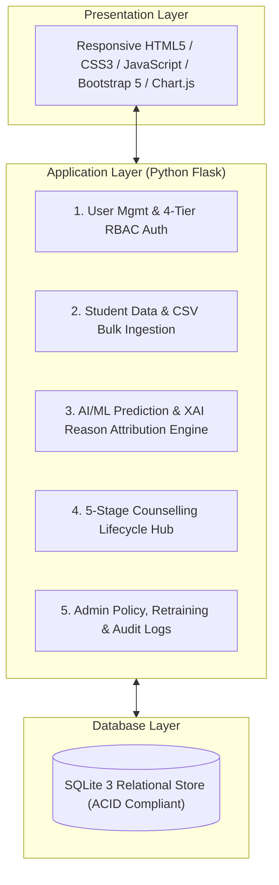

# AI-Based Prediction of Reasons for Student Dropout
**Sanskriti University &bull; School of Engineering and Information Technology (SOEIT)**

[](https://render.com/deploy?repo=https://github.com/Shannu1423/student-dropout-prediction)

* **Candidate 1:** DESIREDDY RAMESH (Enrollment No: `2302320099`)
* **Candidate 2:** Shaik Shafi (Enrollment No: `2302320151`)
* **Faculty Guide:** Mr. Satyam Dwivedi, Assistant Professor, SOEIT
* **Academic Year:** 2026–2027 (November 2026)
* **GitHub Repository:** [https://github.com/Shannu1423/student-dropout-prediction.git](https://github.com/Shannu1423/student-dropout-prediction.git)

---

## 🚀 Live Cloud Deployment

This project is pre-configured for **1-click free cloud deployment** on Render, Railway, or any WSGI host.

### Option 1: 1-Click Deploy on Render (Recommended & Free)
1. Click the **Deploy to Render** button above, or go to [dashboard.render.com](https://dashboard.render.com).
2. Sign in with your GitHub account (`Shannu1423`).
3. Click **"New +"** &rarr; **"Web Service"**.
4. Select repository: `Shannu1423/student-dropout-prediction`.
5. Render automatically detects the configuration from `render.yaml` and `Procfile`:
   - **Environment:** `Python`
   - **Build Command:** `pip install -r requirements.txt`
   - **Start Command:** `gunicorn "app:create_app()"`
   - **Plan:** `Free`
6. Click **"Deploy Web Service"**.
7. In ~2 minutes, your web application will be live at a public HTTPS URL (e.g., `https://student-dropout-prediction.onrender.com`)!

---

### Option 2: Run Locally (Offline)
1. Open PowerShell or Command Prompt:
   ```powershell
   cd C:\Users\ASUS\.gemini\antigravity\scratch\student_dropout_prediction
   ```
2. Start the application:
   ```powershell
   .venv\Scripts\python.exe app.py
   ```
3. Open your browser and navigate to: **`http://127.0.0.1:5000`**

---

## 🔑 Demo Login Credentials

The system provides 4 pre-configured roles with strict Role-Based Access Control (RBAC):

| Role | Username | Password | Operational Access Level |
| :--- | :--- | :--- | :--- |
| **Administrator** | `admin` | `password123` | Full control: Risk thresholds, model retraining, queue limits, audit logs |
| **Guide / HOD** | `satyam` | `password123` | Department risk registry, mentor assignments, case escalations |
| **Faculty Mentor** | `priya` | `password123` | Assigned student cases, XAI reason cards, session notes, stage advancement |
| **Student** | `ramesh` | `password123` | Read-only access strictly isolated to own academic performance and advice |

---

## 1. System Overview & Objectives
The **AI-Based Prediction of Reasons for Student Dropout** system is a centralized web portal and machine learning analytics platform. It replaces fragmented practices (paper registers, spreadsheets, informal follow-ups) with an automated early-warning system that:
1. **Monitors Multi-Factor Data:** Ingests academic records, attendance percentages, backlog counts, fee payment statuses, and LMS engagement scores.
2. **Predicts Dropout Risk:** Employs trained classification models (Random Forest and Logistic Regression) built with `scikit-learn` achieving **93.3% accuracy** and **0.965 AUC-ROC**.
3. **Explains Reasons (Explainable AI / XAI):** Computes individualized feature attribution cards so mentors know *why* a student was flagged (e.g., Attendance Deficit, Internal Assessment Deficit, Fee Arrears).
4. **Tracks Interventions Across Lifecycle:** Manages at-risk students through a 5-stage retention workflow:
   $$\text{New} \longrightarrow \text{Under Review} \longrightarrow \text{In Progress} \longrightarrow \text{Resolved} \Big/ \text{Escalated}$$
5. **Queue Workload Protection:** Visual capacity meters monitor caseload per mentor to prevent counselor burnout.
6. **Peer Data Privacy:** Strict session-level data isolation prevents student peer inspection.

---

## 2. Decoupled Architectural Modules



---

## 3. Technology Stack
* **Backend Framework:** Python (Flask 3.1), WSGI Gunicorn, REST APIs, PBKDF2 Session Authentication
* **Machine Learning:** scikit-learn 1.9+, pandas, numpy, joblib (Random Forest & Logistic Regression)
* **Database & ORM:** SQLite 3, SQLAlchemy 2.1
* **Frontend UI/UX:** Bootstrap 5.3, FontAwesome 6, Chart.js 4.4
* **Documentation & Reports:** ReportLab 5.1 (Exact 77-page academic B.Tech report PDF)

---

## 4. Documentation & Handover Artifacts
* 📄 **[PROJECT_REPORT.pdf](PROJECT_REPORT.pdf)**: Official 77-page Sanskriti University final B.Tech capstone project report.
* 📘 **[ADMIN_OPERATIONS_MANUAL.md](ADMIN_OPERATIONS_MANUAL.md)**: Comprehensive operations and handover guide for administrators and seniors.
* 🌐 **[PROJECT_REPORT.html](PROJECT_REPORT.html)**: Interactive, printable academic web report.
