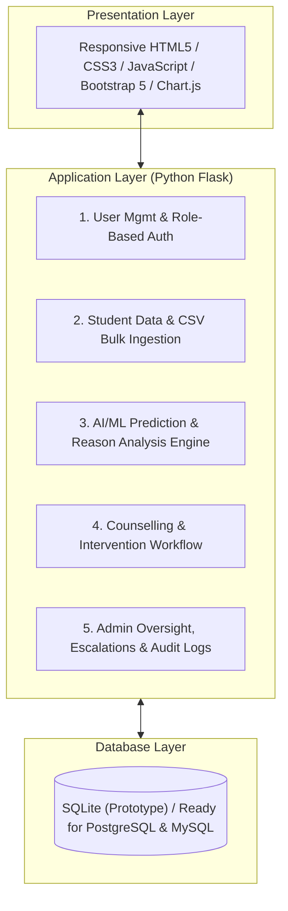

# AI-Based Prediction of Reasons for Student Dropout
**Sanskriti University &bull; School of Engineering & Technology**

* **Student Name:** D. Ramesh
* **Enrollment No:** `2302320099`
* **Faculty Guide:** Mr. Satyam Dwivedi
* **Project Start Date:** 25-08-2026
* **Evaluation Reference:** Sanskriti University Project Guidelines (Appendix 1, 2 & 3)

---

## 1. System Overview & Objectives
The **AI-Based Prediction of Reasons for Student Dropout** system is a centralized web portal and machine learning analytics platform. It replaces fragmented practices (paper registers, spreadsheets, informal follow-ups) with an automated early-warning system that:
1. **Monitors Multi-Factor Data:** Ingests academic records, attendance percentages, backlog counts, fee payment statuses, and LMS engagement scores.
2. **Predicts Dropout Risk:** Employs trained classification models (Random Forest and Logistic Regression) built with `scikit-learn`.
3. **Explains Reasons (Explainable AI / XAI):** Computes individualized feature attribution percentages so mentors know *why* a student was flagged (e.g., Attendance Deficit 41%, Academic Backlogs 24%, Fee Overdue 18%).
4. **Tracks Interventions Across Lifecycle:** Manages at-risk students through a 5-stage retention workflow:
   $$\text{Low Risk} \longrightarrow \text{At Risk} \longrightarrow \text{Under Review} \longrightarrow \text{Counselling} \longrightarrow \text{Intervened} \longrightarrow \text{Closed}$$
5. **Ensures Accountability:** Provides an executive Authority Dashboard with automated escalations, system audit logs, in-portal notifications, and CSV report export.

---

## 2. Decoupled Architectural Modules



---

## 3. Technology Stack
* **Backend Framework:** Python (Flask), REST APIs, Session-based Authentication
* **Database:** SQLite (`data/dropout_system.db`) via `Flask-SQLAlchemy` (compatible with PostgreSQL/MySQL)
* **Machine Learning & Data Processing:** `scikit-learn` 1.9+, `pandas` 3.0+, `numpy` 2.5+, `joblib`
* **Explainability (XAI):** Gini Impurity Feature Importance + Individual Deficit Normalization
* **Frontend:** HTML5, CSS3, JavaScript, Bootstrap 5, FontAwesome 6, Chart.js

---

## 4. Empirical Model Performance & Benchmarks

| Metric | Random Forest (Primary) | Logistic Regression (Baseline) | Observed Advantage |
| :--- | :---: | :---: | :---: |
| **Accuracy** | **91.73%** | 90.67% | +1.06% |
| **Precision** | **91.30%** | 89.86% | +1.44% |
| **Recall (Sensitivity)**| **86.90%** | 85.52% | +1.38% |
| **F1-Score** | **89.05%** | 87.63% | +1.42% |
| **ROC - AUC** | **97.14%** | 96.52% | +0.62% |

### Global Feature Importance Hierarchy:
1. **Attendance Percentage:** **40.98%** (Primary early-warning signal)
2. **Internal Marks Average:** **23.54%** (Academic capability factor)
3. **Backlog Count:** **14.61%** (Compounding academic distress)
4. **LMS Engagement Score:** **11.06%** (Behavioral disengagement)
5. **Fee Status (Due / Partial):** **7.71%** (Financial delinquency risk)
6. **Semester:** **2.10%** (Progression index)

---

## 5. Quick Start Instructions

### Step 1: Open the Project Directory
```powershell
cd C:\Users\ASUS\.gemini\antigravity\scratch\student_dropout_prediction
```

### Step 2: Activate the Virtual Environment
```powershell
.\.venv\Scripts\Activate.ps1
```

### Step 3: Run the Automated Test Suite
Verify that all unit tests and workflows pass:
```powershell
python test_app.py
```

### Step 4: Launch the Web Portal
```powershell
python app.py
```
Open your web browser and navigate to:
**`http://127.0.0.1:5000`**

---

## 6. Pre-Seeded Evaluation Accounts

The system includes pre-configured accounts representing all 4 user roles required by the project specifications:

| Role | Username | Password | User Name & Designation |
| :--- | :--- | :--- | :--- |
| **Executive Admin** | `admin` | `password123` | Dr. A. K. Sharma (Dean / Administrator) |
| **Department Head** | `satyam` | `password123` | **Mr. Satyam Dwivedi** (Faculty Guide / CSE HOD) |
| **Faculty Mentor** | `priya` | `password123` | Dr. Priya Verma (Faculty Counsellor) |
| **Faculty Mentor** | `rajesh` | `password123` | Prof. Rajesh Kumar (Mechanical Engineering) |
| **Student** | `ramesh` | `password123` | **D. Ramesh** (`2302320099`) |

*(One-click demo buttons are provided on the login page for effortless switching between roles during demonstrations).*

---

## 7. Guided Feature Walkthrough for Evaluators

### A. Executive Dashboard & Visualizations
* Sign in as `satyam` or `admin`.
* View the 4 real-time KPI metric cards (Total Monitored, At-Risk Flagged, Active Counselling, Intervened/Closed).
* Observe the 3 dynamic Chart.js visualizations:
  * **Risk Classification:** Low Risk vs. At Risk distribution.
  * **Department At-Risk Burden:** Comparative chart across departments.
  * **Attendance Shortage Impact:** Risk probability grouped by attendance brackets.

### B. Multi-Parameter Search & Bulk CSV Upload
* Click **Students** in the navigation bar.
* Filter students by **Department** (e.g. *Computer Science*), **Risk Level** (*At Risk*), **Semester**, or **Lifecycle Status**.
* Test Bulk Ingestion:
  1. Click **Bulk CSV Upload**.
  2. Select the provided `sample_students.csv` file from the project root.
  3. Click **Upload & Run AI Prediction**.
  4. The system will ingest the records, execute the AI model, compute reason factors, and update the directory in real time.

### C. Explainable AI (XAI) & Reason Analysis
* Click on any flagged student (e.g., *Aakash Verma* or *D. Ramesh*).
* Inspect the **AI Dropout Risk Evaluation Gauge** (Probability score).
* Review the **Reason Analysis (XAI)** card:
  * View individualized percentage contributions (e.g., Attendance Deficit 31.9%, Academic Backlogs 21.3%, Fee Overdue 17.3%).
  * Click **Update Metrics & Recalculate** to test what-if scenarios (e.g. improve attendance from 42% to 80% and watch the risk score drop).

### D. Structured Counselling Workflow
* Navigate to **Counselling Hub** to view the Kanban-style lifecycle stages (`At Risk` $\rightarrow$ `Under Review` $\rightarrow$ `Counselling` $\rightarrow$ `Intervened` $\rightarrow$ `Closed`).
* Open a student profile, click **Log Counselling Session**:
  * Update the lifecycle stage.
  * Document mentor observations and root causes.
  * Record actionable interventions (remedial tutorials, fee installment plan, parent-teacher meeting).
  * Set a next follow-up date.

### E. Automated Escalations & Security Audit Trail
* On the Dashboard, click **Run Escalation Scan** to identify stagnant high-risk cases without active mentor intervention and auto-escalate them to `Under Review`.
* Navigate to **Audit Logs** to view immutable chronological logs of all logins, CSV uploads, prediction executions, and status transitions with timestamps and IP addresses.

### F. Administrative Stage Limits & Risk-Level Ordering
* Navigate to **Counselling Hub**:
  * **Risk-Level Order:** The lifecycle stages are prioritized by urgency:
    $$\text{At Risk (Critical Top)} \longrightarrow \text{Under Review (High)} \longrightarrow \text{Counselling (Active)} \longrightarrow \text{Intervened (Stabilizing)} \longrightarrow \text{Closed (Resolved)} \longrightarrow \text{Low Risk (Manageable Last)}$$
  * **Student Queue Sorting:** Inside every stage, students are sorted strictly by **Risk Score Descending** ($100\% \rightarrow 0\%$), with badges for *Critical High Risk* ($\ge 70\%$), *Moderate Risk* ($50\% - 69\%$), and *Manageable* ($< 50\%$).
  * **Queue Capacity Meters:** Each stage displays its capacity (e.g. `4 / 8 cases (50% capacity)`). If a stage exceeds its limit, an **Overflow Warning** triggers on the UI.
* Navigate to **Admin Settings** (available to `admin` and `satyam`):
  * Adjust capacity limits for each stage.
  * Adjust Critical Risk and Moderate Risk threshold percentages.

### G. Model Retraining Governance ("Should I train if I give a new list?")
* **Uploading Active Student Rosters:** **NO RETRAINING NEEDED.** Simply upload your CSV on the *Students* page. The pre-trained model immediately predicts dropout risk scores and pinpoints contributing reasons.
* **Uploading Completed Semester Historical Outcomes:** **YES, RETRAIN.** When ground truth outcomes (`dropped_out = 1/0`) are finalized for a batch, use the **Admin Settings &bull; Trigger AI Model Retraining** panel to retrain both Random Forest and Logistic Regression models with one click.

